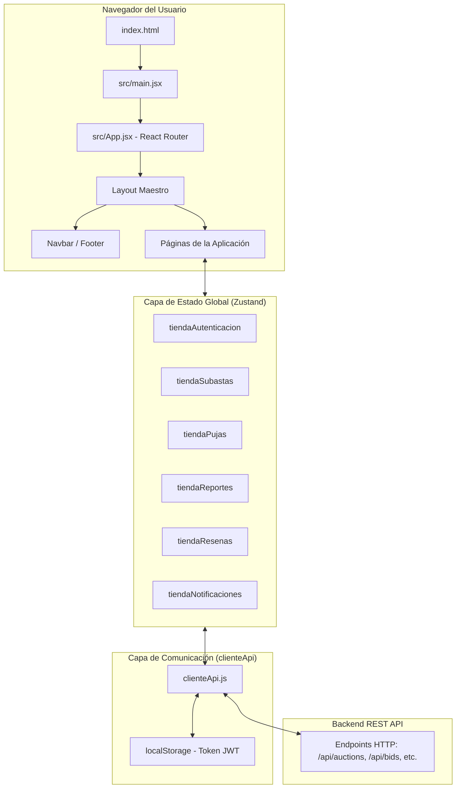
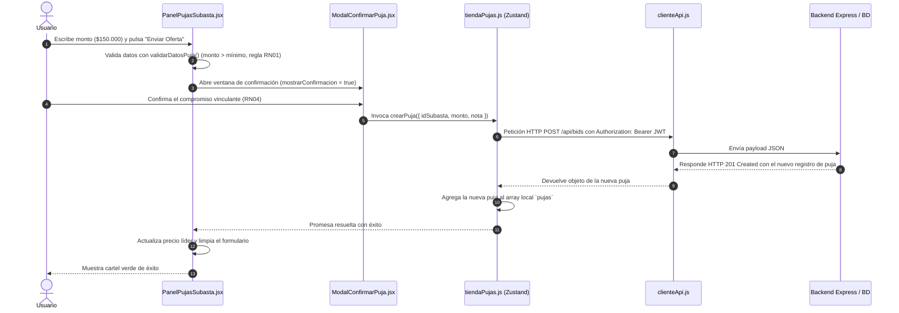

# 📚 BidZone — Documentación de Estudio y Aprendizaje (React + JavaScript)

> **Bienvenido a la guía de estudio de BidZone.**  
> Este documento fue redactado con un enfoque **didáctico y formativo**, pensado para que cualquier estudiante o desarrollador con conocimientos iniciales de JavaScript y React pueda entender **qué hace cada archivo**, **cómo viajan los datos**, **por qué se tomaron ciertas decisiones de diseño** y **cómo funciona la arquitectura general** de una aplicación web profesional de subastas en vivo.

---

## 📑 Tabla de Contenidos
1. [Descripción General de la Aplicación](#1-descripción-general-de-la-aplicación)
2. [Tecnologías y Dependencias Utilizadas](#2-tecnologías-y-dependencias-utilizadas)
3. [Explicación de la Estructura de Carpetas](#3-explicación-de-la-estructura-de-carpetas)
4. [Función de Cada Archivo Importante](#4-función-de-cada-archivo-importante)
5. [Arquitectura General del Proyecto](#5-arquitectura-general-del-proyecto)
6. [Relación y Jerarquía de Componentes](#6-relación-y-jerarquía-de-componentes)
7. [Flujo de Datos de la Aplicación](#7-flujo-de-datos-de-la-aplicación)
8. [Explicación del Funcionamiento de los Hooks](#8-explicación-del-funcionamiento-de-los-hooks)
9. [Comunicación entre Componentes (Props, Eventos y Callbacks)](#9-comunicación-entre-componentes-props-eventos-y-callbacks)
10. [Flujo de las Peticiones a APIs](#10-flujo-de-las-peticiones-a-apis)
11. [Explicación de las Funcionalidades Principales y Reglas de Negocio](#11-explicación-de-las-funcionalidades-principales-y-reglas-de-negocio)
12. [Punto de Entrada: Recorrido desde el Arranque hasta la Pantalla](#12-punto-de-entrada-recorrido-desde-el-arranque-hasta-la-pantalla)

---

## 1. Descripción General de la Aplicación

**BidZone** es una plataforma de **subastas en vivo (marketplace peer-to-peer con mediación)**.

### ¿Qué problema resuelve?
Permite a usuarios registrados publicar artículos en subasta con un precio base y un incremento mínimo. Otros usuarios pueden ofertar en tiempo real mediante **pujas vinculantes**. Al llegar la fecha y hora de cierre, la subasta finaliza automáticamente y se adjudica al mejor postor. En ese instante, y solo en ese instante, el sistema desbloquea los datos de contacto directo (WhatsApp, teléfono, correo) entre vendedor y comprador para que coordinen el pago y la entrega.

Si ocurre algún conflicto (por ejemplo, el comprador no paga o el vendedor no entrega), existe un sistema formal de **tickets de mediación (reportes)** gestionado por administradores, así como un sistema de **reputación y reseñas mutuas (1 a 5 estrellas)**.

### Reglas de Negocio Clave (RN01 - RN08)
- **RN01 (Incremento Mínimo):** Toda puja debe superar al menos el precio actual más el `minIncrement`.
- **RN02 (Prohibición de Auto-puja):** El vendedor dueño de una subasta no puede pujar en su propia publicación.
- **RN03 (Cierre por Tiempo):** Una subasta con fecha cumplida pasa a estado finalizada y no admite más ofertas.
- **RN04 (Irrevocabilidad de Oferta):** Una vez enviada una puja, su monto monetario no puede modificarse ni borrarse (solo puede editarse una nota de coordinación aclaratoria).
- **RN05 (Liberación Condicional de Contacto):** Los datos telefónicos y de contacto solo son visibles para el vendedor y el ganador una vez cerrada la subasta.
- **RN06 (Mesa de Mediación y Sanción):** Los usuarios pueden abrir tickets ante incumplimientos, y el administrador puede resolverlos aplicando sanciones (advertencia, suspensión temporal o cierre definitivo de cuenta).
- **RN07 (Reseña Mutua P2P):** Solo comprador y vendedor de una subasta concluida pueden calificarse entre sí con 1 a 5 estrellas, recalculando el promedio de reputación del usuario calificado.
- **RN08 (Inmutabilidad por Oferta Existente):** Si una subasta ya recibió al menos una puja, el vendedor no puede alterar su precio base, incremento ni fecha de fin (solo un administrador con privilegios puede moderarla).

---

## 2. Tecnologías y Dependencias Utilizadas

| Tecnología | Versión | ¿Para qué sirve en este proyecto? | ¿Por qué es importante para un principiante? |
| :--- | :--- | :--- | :--- |
| **React** | `19.3.1` | Biblioteca base para construir la interfaz mediante componentes declarativos y reactivos. | Permite dividir la pantalla en bloques independientes (`Navbar`, `TarjetaSubasta`, etc.) que se actualizan automáticamente cuando cambian sus datos (`state`). |
| **React DOM** | `19.3.1` | Conector que toma los componentes de React y los dibuja en el árbol DOM del navegador web. | Es el puente entre el código JavaScript y el HTML que el usuario ve y toca. |
| **React Router DOM** | `7.18.5` | Enrutador del lado del cliente (SPA - Single Page Application). | Permite cambiar de pantalla (`/`, `/subastas`, `/panel`) sin recargar la página completa en el navegador. |
| **Zustand** | `5.1.0` | Gestor de estado global ligero y modular. | Es una alternativa moderna y mucho más sencilla que Redux. Permite que múltiples pantallas compartan datos (como el usuario conectado o la lista de subastas) sin pasar "props" por 10 niveles de componentes. |
| **Tailwind CSS** | `4.3.5` | Framework de estilos CSS mediante clases de utilidad directas en el JSX. | Permite dar estilo a los elementos (`p-4`, `bg-[#224F10]`, `rounded-2xl`, `flex`) sin tener que saltar constantemente a un archivo `.css` separado. |
| **Lucide React** | `1.71.0` | Colección de íconos SVG vectoriales listos para usar como componentes React. | Proporciona íconos nítidos y coherentes (`Gavel`, `Clock`, `User`, `Plus`, `Search`, etc.). |
| **Vite** | `8.3.5` | Herramienta de compilación y servidor de desarrollo ultra-rápido. | Procesa el JSX, levanta el servidor local (`http://localhost:5173`) con recarga instantánea (HMR) y genera los archivos optimizados para producción. |
| **Oxlint** | `1.89.0` | Linter de alto rendimiento en Rust para JavaScript y React. | Analiza el código en milisegundos buscando errores comunes, variables no usadas o malas prácticas de hooks. |

---

## 3. Explicación de la Estructura de Carpetas

El proyecto sigue una **arquitectura modular orientada al dominio** (Feature-based Architecture). En lugar de tener una carpeta gigante con 50 componentes mezclados, cada área del negocio tiene su propio directorio:

```text
BidZone/
├── index.html                     <- Archivo HTML base donde se monta la aplicación
├── package.json                   <- Lista de librerías, scripts de npm y dependencias
├── vite.config.js                 <- Configuración de Vite y plugin de React + Tailwind
├── README.md                      <- Guía general del proyecto y comandos de inicio
├── DOCUMENTACION.md               <- Esta guía detallada de estudio y aprendizaje
└── src/                           <- Todo el código fuente de la aplicación
    ├── main.jsx                   <- Punto de entrada JS que monta React en el DOM
    ├── App.jsx                    <- Configuración de rutas (Router) y diseño maestro
    ├── index.css                  <- Estilos globales y directivas de Tailwind CSS
    │
    └── modulos/                   <- Código dividido por funcionalidad de negocio
        ├── nucleo/                <- Elementos transversales compartidos por toda la app
        │   ├── componentes/       <- Vistas comunes (Inicio, Panel, Navbar, Footer...)
        │   │   └── panel/         <- Pestañas del Panel de Control (Tabs y tarjetas)
        │   ├── diseno/            <- Componentes visuales reutilizables (Botones, Inputs, Cards...)
        │   ├── servicios/         <- Cliente HTTP para hablar con el Backend (API REST)
        │   └── utilidades/        <- Funciones auxiliares puras (formatos, reloj, comparadores)
        │
        ├── autenticacion/         <- Módulo de Usuarios y Sesiones (JWT)
        │   ├── componentes/       <- Vistas de Login, Registro, Crear/Editar Usuario
        │   └── estado/            <- Tienda Zustand (usuario logueado, lista de usuarios)
        │
        ├── subastas/              <- Módulo central de Subastas
        │   ├── componentes/       <- Catálogo, Detalle, Publicar, Editar, Tarjeta, Filtros
        │   ├── estado/            <- Tienda Zustand (subastas, filtros de búsqueda, paginación)
        │   └── utilidades/        <- Lógica pura de ordenamiento, filtros y galería
        │
        ├── pujas/                 <- Módulo de Ofertas Vinculantes
        │   ├── componentes/       <- Formulario de puja, modal de confirmación, historial
        │   └── estado/            <- Tienda Zustand (listado de ofertas, reglas de validación)
        │
        ├── reportes/              <- Módulo de Reclamos y Mesa de Mediación RN06
        │   ├── componentes/       <- Formularios de tickets y panel de resolución de sanción
        │   └── estado/            <- Tienda Zustand (reportes abiertos y resueltos)
        │
        ├── resenas/               <- Módulo de Calificaciones Mutuas P2P RN07
        │   ├── componentes/       <- Formulario de reseña, estrellas (1 a 5), tarjetas
        │   ├── estado/            <- Tienda Zustand (reseñas y cálculo de reputación)
        │   └── utilidades/        <- Subastas pendientes de calificar y roles
        │
        └── notificaciones/        <- Módulo de Avisos al Usuario
            └── estado/            <- Tienda Zustand (notificaciones leídas y no leídas)
```

### ¿Por qué esta estructura es superior para aprender?
1. **Localización inmediata:** Si necesitas modificar cómo se crea una puja, vas a `src/modulos/pujas/`.
2. **Cero acoplamiento innecesario:** Las utilidades matemáticas de subastas están en su carpeta de subastas, no mezcladas con el formato de fechas.
3. **Escalabilidad:** Agregar un módulo nuevo (por ejemplo `pagos/` o `envios/`) no rompe los módulos existentes.

---

## 4. Función de Cada Archivo Importante

A continuación se resume la responsabilidad de cada archivo del proyecto para que puedas orientarte rápidamente:

### Raíz de `src/`
- [main.jsx](file:///c:/Users/leooo/OneDrive/Escritorio/Code/Proyectos/BidZone/BidZone/src/main.jsx): Punto de arranque del navegador. Encuentra `<div id="root">` y ejecuta `createRoot().render(<App />)`.
- [App.jsx](file:///c:/Users/leooo/OneDrive/Escritorio/Code/Proyectos/BidZone/BidZone/src/App.jsx): Define el árbol de rutas (`/`, `/subastas`, `/panel`, etc.) con `BrowserRouter` y asocia cada URL a su componente visual.
- [index.css](file:///c:/Users/leooo/OneDrive/Escritorio/Code/Proyectos/BidZone/BidZone/src/index.css): Carga Tailwind CSS v4 y define las fuentes tipográficas del sistema.

### Módulo Núcleo (`src/modulos/nucleo/`)
- **Servicios:**
  - [clienteApi.js](file:///c:/Users/leooo/OneDrive/Escritorio/Code/Proyectos/BidZone/BidZone/src/modulos/nucleo/servicios/clienteApi.js): Envoltorio central para `fetch()`. Agrega encabezados JSON y el token JWT de autenticación en cada petición al backend.
- **Utilidades:**
  - [ayudas.js](file:///c:/Users/leooo/OneDrive/Escritorio/Code/Proyectos/BidZone/BidZone/src/modulos/nucleo/utilidades/ayudas.js): Funciones de ayuda sin interfaz gráfica (`mismoId`, `buscarPorId`, `validarDatosPuja`, `paginarLista`, `useRelojSegundo`).
  - [formatos.js](file:///c:/Users/leooo/OneDrive/Escritorio/Code/Proyectos/BidZone/BidZone/src/modulos/nucleo/utilidades/formatos.js): Conversores de texto y números (`formatearMoneda`, `calcularTiempoRestante`, `formatearRolUsuario`, categorías de subastas).
- **Diseño (Sistema de componentes UI):**
  - [ui.jsx](file:///c:/Users/leooo/OneDrive/Escritorio/Code/Proyectos/BidZone/BidZone/src/modulos/nucleo/diseno/ui.jsx): Elementos base de formulario (`Button`, `Input`, `Select`, `Textarea`, `Badge`, `Card`).
  - [uiFeedback.jsx](file:///c:/Users/leooo/OneDrive/Escritorio/Code/Proyectos/BidZone/BidZone/src/modulos/nucleo/diseno/uiFeedback.jsx): Elementos de retroalimentación al usuario (`Alert`, `Modal`, `Loading`, `ErrorCard`).
  - [componentesBloques.jsx](file:///c:/Users/leooo/OneDrive/Escritorio/Code/Proyectos/BidZone/BidZone/src/modulos/nucleo/diseno/componentesBloques.jsx): Estructuras de página compuestas (`CabeceraPagina`, `FiltrosBotones`, `PaginaFormulario`, `AccionesFormulario`).
- **Vistas Generales:**
  - [Layout.jsx](file:///c:/Users/leooo/OneDrive/Escritorio/Code/Proyectos/BidZone/BidZone/src/modulos/nucleo/componentes/Layout.jsx): Marco visual que envuelve a todas las páginas con la barra superior `Navbar` y el pie `Footer`.
  - [Navbar.jsx](file:///c:/Users/leooo/OneDrive/Escritorio/Code/Proyectos/BidZone/BidZone/src/modulos/nucleo/componentes/Navbar.jsx): Menú de navegación principal con buscador en vivo, indicador de notificaciones y enlaces de sesión.
  - [Footer.jsx](file:///c:/Users/leooo/OneDrive/Escritorio/Code/Proyectos/BidZone/BidZone/src/modulos/nucleo/componentes/Footer.jsx): Pie de página con enlaces institucionales, contacto y reglas del sistema.
  - [Inicio.jsx](file:///c:/Users/leooo/OneDrive/Escritorio/Code/Proyectos/BidZone/BidZone/src/modulos/nucleo/componentes/Inicio.jsx): Portada principal que combina el hero publicitario, catálogo destacado y secciones de confianza.
  - [RutaProtegida.jsx](file:///c:/Users/leooo/OneDrive/Escritorio/Code/Proyectos/BidZone/BidZone/src/modulos/nucleo/componentes/RutaProtegida.jsx): Guardián de seguridad que redirige a `/iniciar-sesion` si no hay sesión activa o si se requieren permisos de administrador.
  - [VistaPanelControl.jsx](file:///c:/Users/leooo/OneDrive/Escritorio/Code/Proyectos/BidZone/BidZone/src/modulos/nucleo/componentes/VistaPanelControl.jsx): Centro de comando integral (`/panel`) con barra lateral y pestañas para cada módulo.

### Módulo de Subastas (`src/modulos/subastas/`)
- [tiendaSubastas.js](file:///c:/Users/leooo/OneDrive/Escritorio/Code/Proyectos/BidZone/BidZone/src/modulos/subastas/estado/tiendaSubastas.js): Estado global con la lista de subastas, subasta seleccionada, filtros activos y métodos asíncronos (`obtenerSubastas`, `crearSubasta`, `actualizarSubasta`, `eliminarSubasta`).
- [filtrosSubasta.js](file:///c:/Users/leooo/OneDrive/Escritorio/Code/Proyectos/BidZone/BidZone/src/modulos/subastas/utilidades/filtrosSubasta.js): Algoritmo de filtrado por texto, categoría, estado en vivo y ordenamiento (más baratas, más caras, próximas a cerrar).
- [TarjetaSubasta.jsx](file:///c:/Users/leooo/OneDrive/Escritorio/Code/Proyectos/BidZone/BidZone/src/modulos/subastas/componentes/TarjetaSubasta.jsx): Ficha individual del artículo en el catálogo (foto, precio actual, temporizador en vivo y botones de acción).
- [VistaListaSubastas.jsx](file:///c:/Users/leooo/OneDrive/Escritorio/Code/Proyectos/BidZone/BidZone/src/modulos/subastas/componentes/VistaListaSubastas.jsx): Pantalla completa del catálogo (`/subastas`) con filtros dinámicos y paginación.
- [VistaDetalleSubasta.jsx](file:///c:/Users/leooo/OneDrive/Escritorio/Code/Proyectos/BidZone/BidZone/src/modulos/subastas/componentes/VistaDetalleSubasta.jsx): Pantalla de subasta individual (`/subastas/:id`) donde conviven la descripción, fotos, datos del vendedor, panel de pujas e historial.
- [FormularioSubasta.jsx](file:///c:/Users/leooo/OneDrive/Escritorio/Code/Proyectos/BidZone/BidZone/src/modulos/subastas/componentes/FormularioSubasta.jsx): Formulario unificado para publicar un lote nuevo o editar uno existente respetando RN08.

### Módulo de Pujas (`src/modulos/pujas/`)
- [tiendaPujas.js](file:///c:/Users/leooo/OneDrive/Escritorio/Code/Proyectos/BidZone/BidZone/src/modulos/pujas/estado/tiendaPujas.js): Estado global de ofertas y llamadas a la API para enviar pujas (`crearPuja`).
- [PanelPujasSubasta.jsx](file:///c:/Users/leooo/OneDrive/Escritorio/Code/Proyectos/BidZone/BidZone/src/modulos/subastas/componentes/PanelPujasSubasta.jsx): Interfaz reactiva para ofertar en tiempo real con cálculo automático del monto mínimo sugerido.
- [ModalConfirmarPuja.jsx](file:///c:/Users/leooo/OneDrive/Escritorio/Code/Proyectos/BidZone/BidZone/src/modulos/pujas/componentes/ModalConfirmarPuja.jsx): Ventana modal que exige al postor confirmar su oferta vinculante para evitar ofertas accidentales.

### Módulo de Autenticación (`src/modulos/autenticacion/`)
- [tiendaAutenticacion.js](file:///c:/Users/leooo/OneDrive/Escritorio/Code/Proyectos/BidZone/BidZone/src/modulos/autenticacion/estado/tiendaAutenticacion.js): Maneja la sesión del usuario (`usuarioActual`), persistencia en `localStorage`, login, registro y lista de usuarios para el administrador.
- [VistaIniciarSesion.jsx](file:///c:/Users/leooo/OneDrive/Escritorio/Code/Proyectos/BidZone/BidZone/src/modulos/autenticacion/componentes/VistaIniciarSesion.jsx): Formulario de acceso con credenciales demo preconfiguradas.
- [VistaRegistro.jsx](file:///c:/Users/leooo/OneDrive/Escritorio/Code/Proyectos/BidZone/BidZone/src/modulos/autenticacion/componentes/VistaRegistro.jsx): Formulario de alta para nuevos miembros.

### Módulos de Soporte (Reportes, Reseñas, Notificaciones)
- [tiendaReportes.js](file:///c:/Users/leooo/OneDrive/Escritorio/Code/Proyectos/BidZone/BidZone/src/modulos/reportes/estado/tiendaReportes.js): Administración de tickets de mediación RN06.
- [PanelResolucionTicket.jsx](file:///c:/Users/leooo/OneDrive/Escritorio/Code/Proyectos/BidZone/BidZone/src/modulos/reportes/componentes/PanelResolucionTicket.jsx): Panel exclusivo para administradores para sancionar o desestimar reclamos.
- [tiendaResenas.js](file:///c:/Users/leooo/OneDrive/Escritorio/Code/Proyectos/BidZone/BidZone/src/modulos/resenas/estado/tiendaResenas.js): Calificaciones de 1 a 5 estrellas y promedio de reputación.
- [tiendaNotificaciones.js](file:///c:/Users/leooo/OneDrive/Escritorio/Code/Proyectos/BidZone/BidZone/src/modulos/notificaciones/estado/tiendaNotificaciones.js): Bandeja de avisos del sistema con contador no leídos.

---

## 5. Arquitectura General del Proyecto

BidZone implementa el patrón **Frontend Monolítico Reactivo**:



### Principios Fundamentales:
1. **Flujo Unidireccional:** Las vistas no mutan variables globales directamente. Despachan acciones a las tiendas de Zustand (`crearSubasta(datos)`), las tiendas se comunican con el servidor mediante `clienteApi`, reciben la respuesta y actualizan el estado inmutablemente. Al actualizarse el estado, React re-renderiza automáticamente solo los componentes interesados.
2. **Componentes Presentacionales vs Contenedores:** Los componentes pequeños (`Button`, `Badge`, `TarjetaSubasta`) son casi 100% de presentación (reciben props y disparan callbacks). Las vistas de página (`VistaListaSubastas`, `VistaPanelControl`) actúan como contenedores que conectan la tienda Zustand con la interfaz.

---

## 6. Relación y Jerarquía de Componentes

Veamos cómo se anidan los componentes en la pantalla principal del catálogo (`/subastas`):

```text
App.jsx (Router)
└── Layout.jsx (Marco estructural)
    ├── Navbar.jsx (Buscador, Sesión, Campana de notificaciones)
    ├── VistaListaSubastas.jsx (Página de catálogo)
    │   ├── CabeceraPagina.jsx (Título y botón '+ Publicar')
    │   ├── Alert.jsx (Mensajes de error o éxito si existen)
    │   ├── FiltrosBotones.jsx (Selector horizontal de categorías)
    │   ├── Card.jsx (Caja con Inputs y Selects de búsqueda y orden)
    │   │   ├── Input.jsx (Buscador de texto)
    │   │   ├── Select.jsx (Filtro 'Activas / Finalizadas')
    │   │   └── Select.jsx (Orden 'Precio menor / mayor / cierre')
    │   ├── Grilla de Subastas (grid grid-cols-4)
    │   │   ├── TarjetaSubasta.jsx (Lote 1)
    │   │   │   ├── Badge.jsx (Estado y categoría)
    │   │   │   ├── Temporizador en vivo (Clock)
    │   │   │   └── Botón 'Participar / Ver Lote'
    │   │   ├── TarjetaSubasta.jsx (Lote 2)...
    │   │   └── TarjetaCtaCatalogo.jsx (Tarjeta invitando a vender)
    │   ├── PaginacionCatalogo.jsx (Selector de páginas anterior/siguiente)
    │   └── PanelSolicitudCorreccion.jsx (Modal emergente de revisión)
    └── Footer.jsx (Enlaces legales y pie de página)
```

Cada componente hijo tiene una tarea pequeña y clara, permitiendo reutilizar por ejemplo `Badge` o `Button` en decenas de lugares sin reescribir código CSS ni HTML.

---

## 7. Flujo de Datos de la Aplicación

Para entender cómo viaja la información desde que el usuario pulsa un botón hasta que se guarda en la base de datos, veamos el ejemplo de **Enviar una Puja**:



---

## 8. Explicación del Funcionamiento de los Hooks

React utiliza **Hooks** (funciones que empiezan con la palabra `use`) para dotar a los componentes de estado y ciclo de vida sin necesidad de usar clases de JavaScript tradicionales.

### 1. `useState` (Estado Local del Componente)
- **¿Qué es?** Es una cajita de memoria que pertenece a un único componente en la pantalla.
- **Sintaxis:**
  ```javascript
  const [valor, setValor] = useState(valorInicial);
  ```
- **Ejemplo en el proyecto ([PanelPujasSubasta.jsx](file:///c:/Users/leooo/OneDrive/Escritorio/Code/Proyectos/BidZone/BidZone/src/modulos/subastas/componentes/PanelPujasSubasta.jsx)):**
  ```javascript
  const [montoIngresado, setMontoIngresado] = useState(() => obtenerMontoPujaSugerido(subasta));
  ```
  `montoIngresado` almacena lo que el usuario está escribiendo en el `<input>`. Cuando el usuario escribe, se llama a `setMontoIngresado(nuevoTexto)`, lo que le avisa a React que vuelva a dibujar el componente mostrando el nuevo número.

### 2. `useEffect` (Efectos Secundarios)
- **¿Qué es?** Permite ejecutar código en momentos específicos de la vida del componente: cuando aparece por primera vez en pantalla (montaje), cuando cambia algún dato, o cuando desaparece (desmontaje).
- **Ejemplo en el proyecto ([VistaListaSubastas.jsx](file:///c:/Users/leooo/OneDrive/Escritorio/Code/Proyectos/BidZone/BidZone/src/modulos/subastas/componentes/VistaListaSubastas.jsx)):**
  ```javascript
  useEffect(() => {
    obtenerSubastas(); // Descarga los artículos del servidor al entrar a la página
  }, [obtenerSubastas]);
  ```
  El array `[obtenerSubastas]` al final se llama **array de dependencias**. Le dice a React: *"Solo ejecuta esta función una vez al montar la página o si la función obtenerSubastas cambia"*.

### 3. `useRef` (Referencias Directas)
- **¿Qué es?** Crea un contenedor que puede guardar una referencia directa a un elemento del DOM (como un input HTML) sin provocar un re-renderizado cuando cambia.
- **Ejemplo en el proyecto ([VistaIniciarSesion.jsx](file:///c:/Users/leooo/OneDrive/Escritorio/Code/Proyectos/BidZone/BidZone/src/modulos/autenticacion/componentes/VistaIniciarSesion.jsx)):**
  ```javascript
  const campoContrasenaRef = useRef(null);
  // Al hacer clic en un usuario demo, se hace foco automáticamente:
  campoContrasenaRef.current.focus();
  ```

### 4. Custom Hook: `useRelojSegundo` ([ayudas.js](file:///c:/Users/leooo/OneDrive/Escritorio/Code/Proyectos/BidZone/BidZone/src/modulos/nucleo/utilidades/ayudas.js))
- **¿Qué es un Custom Hook?** Es una función propia de JavaScript cuyo nombre comienza con `use` y que combina otros hooks de React para encapsular lógica repetitiva.
- **¿Cómo funciona nuestro reloj?**
  ```javascript
  export function useRelojSegundo(activo = true) {
    const [ahoraMs, setAhoraMs] = useState(() => Date.now());

    useEffect(() => {
      if (!activo) return undefined;
      const intervalo = setInterval(() => setAhoraMs(Date.now()), 1000);
      return () => clearInterval(intervalo); // Limpieza para no dejar timers colgados
    }, [activo]);

    return ahoraMs;
  }
  ```
  Cada 1000 milisegundos (1 segundo) actualiza el estado `ahoraMs`. Cualquier componente que use `const ahoraMs = useRelojSegundo()` se volverá a dibujar cada segundo, logrando que los contadores regresivos de tiempo restante (`02h 45m 12s`) avancen en vivo sin tener que recargar la página.

---

## 9. Comunicación entre Componentes (Props, Eventos y Callbacks)

En React, los datos viajan **de padres a hijos** mediante **Props**, y las notificaciones de eventos viajan **de hijos a padres** mediante **Funciones Callback**.

### Ejemplo Práctico: Eliminar una Subasta
1. El padre ([VistaListaSubastas.jsx](file:///c:/Users/leooo/OneDrive/Escritorio/Code/Proyectos/BidZone/BidZone/src/modulos/subastas/componentes/VistaListaSubastas.jsx)) tiene la función real para eliminar:
   ```javascript
   async function manejarEliminacion(subasta) {
     if (!window.confirm("¿Seguro?")) return;
     await eliminarSubasta(subasta.id);
   }
   ```
2. El padre le pasa esa función a la tarjeta hija mediante una prop:
   ```jsx
   <TarjetaSubasta
     subasta={subasta}
     alEliminar={manejarEliminacion}
   />
   ```
3. La tarjeta hija ([TarjetaSubasta.jsx](file:///c:/Users/leooo/OneDrive/Escritorio/Code/Proyectos/BidZone/BidZone/src/modulos/subastas/componentes/TarjetaSubasta.jsx)) no borra nada directamente. Cuando el usuario hace clic en el botón de tacho de basura, simplemente ejecuta la prop:
   ```jsx
   <button onClick={() => alEliminar(subasta)}>
     <Trash2 /> Eliminar
   </button>
   ```
De esta manera, la tarjeta se mantiene pequeña y reutilizable: solo sabe mostrar la subasta y avisar cuando hacen clic.

---

## 10. Flujo de las Peticiones a APIs

Toda la comunicación con el servidor backend se centraliza en el archivo [clienteApi.js](file:///c:/Users/leooo/OneDrive/Escritorio/Code/Proyectos/BidZone/BidZone/src/modulos/nucleo/servicios/clienteApi.js).

### ¿Por qué centralizar las llamadas a la API?
Si llamáramos a `fetch('http://localhost:3000/api/...')` disperso en 30 componentes diferentes:
- Tendríamos que repetir la URL base en todos lados.
- Tendríamos que recordar adjuntar el token JWT de autenticación en cada archivo.
- Si el backend cambia el formato de errores, tendríamos que arreglar 30 archivos.

### ¿Cómo funciona `clienteApi.js`?
```javascript
export async function pedirApi(ruta, opciones = {}) {
  // 1. Obtiene el token guardado en el navegador (si el usuario inició sesión)
  const token = localStorage.getItem('token_bidzone');

  // 2. Prepara las cabeceras estándar (JSON y Authorization Bearer)
  const cabeceras = { 'Content-Type': 'application/json', ...opciones.headers };
  if (token) cabeceras.Authorization = `Bearer ${token}`;

  // 3. Ejecuta la petición HTTP con la API nativa fetch()
  const respuesta = await fetch(`/api${ruta}`, { ...opciones, headers: cabeceras });

  // 4. Si el servidor respondió con error (400, 401, 404, 500), extrae el mensaje y lanza un Error
  if (!respuesta.ok) {
    const errorJson = await respuesta.json().catch(() => ({}));
    throw new Error(errorJson.message || `Error del servidor (${respuesta.status})`);
  }

  // 5. Si todo salió bien, devuelve los datos ya convertidos a objeto JS
  return respuesta.json();
}
```

Las tiendas de Zustand (`tiendaSubastas`, `tiendaPujas`, etc.) simplemente llaman a:
```javascript
const datos = await pedirApi('/auctions');
```

---

## 11. Explicación de las Funcionalidades Principales y Reglas de Negocio

### 1. Catálogo Dinámico con Búsqueda y Filtros ([filtrosSubasta.js](file:///c:/Users/leooo/OneDrive/Escritorio/Code/Proyectos/BidZone/BidZone/src/modulos/subastas/utilidades/filtrosSubasta.js))
Permite buscar por texto (en título o descripción), por categoría temática (Tecnología, Vehículos, Arte, etc.), por estado de sala (Activas en vivo o Finalizadas) y ordenar por:
- `proximasACerrar`: Menor tiempo restante primero.
- `precioMenor`: Oferta líder más baja primero.
- `precioMayor`: Oferta líder más alta primero.
- `masNuevas`: Fecha de publicación más reciente.

### 2. Panel de Control Unificado ([VistaPanelControl.jsx](file:///c:/Users/leooo/OneDrive/Escritorio/Code/Proyectos/BidZone/BidZone/src/modulos/nucleo/componentes/VistaPanelControl.jsx))
El panel `/panel` es el corazón de la gestión privada del usuario. Cuenta con una barra lateral inteligente que se adapta al rol:
- **Usuario Estándar:** Resumen personal, Mis Subastas publicadas, Mis Pujas realizadas, Mis Reclamos abiertos, Mis Reseñas y Perfil.
- **Administrador:** Además de lo anterior, tiene acceso a **Moderación Global de Subastas**, **Mesa de Mediación de Reclamos RN06** y **Gestión de Cuentas de Usuarios** (suspender, reactivar o asignar roles).

### 3. Liberación de Contacto Post-Cierre RN05 ([PanelContactoSubasta.jsx](file:///c:/Users/leooo/OneDrive/Escritorio/Code/Proyectos/BidZone/BidZone/src/modulos/subastas/componentes/PanelContactoSubasta.jsx))
Mientras la subasta está activa, los teléfonos y correos están estrictamente ocultos para evitar tratos por fuera de la plataforma que deriven en fraudes. Cuando la subasta finaliza (`status === 'finalizada'`), el componente detecta si el usuario conectado es el vendedor o el ganador legítimo. Si es así, desbloquea una tarjeta verde con el enlace directo a WhatsApp y correo para acordar la entrega.

---

## 12. Punto de Entrada: Recorrido desde el Arranque hasta la Pantalla

¿Qué sucede cuando un usuario abre su navegador y entra a `http://localhost:5173/subastas`?

1. **Paso 1 - Carga del HTML:** El navegador descarga `index.html`. Este archivo contiene solo un esqueleto básico con `<div id="root"></div>` y la etiqueta `<script type="module" src="/src/main.jsx"></script>`.
2. **Paso 2 - Ejecución de `main.jsx`:** Vite procesa `main.jsx`. Aquí se importa React 19 y se le indica que renderice el componente `<App />` dentro del `div` con id `root`.
3. **Paso 3 - Resolución de Rutas en `App.jsx`:** `<App />` envuelve todo en un `<BrowserRouter>`. Al ver que la URL actual es `/subastas`, busca entre sus rutas declaradas:
   ```jsx
   <Route path="/subastas" element={<VistaListaSubastas />} />
   ```
4. **Paso 4 - Envoltorio de Diseño en `Layout.jsx`:** Dado que la ruta está anidada dentro de `Layout`, se dibujan primero la barra de navegación `Navbar` y el `Footer`.
5. **Paso 5 - Montaje de `VistaListaSubastas.jsx`:**
   - Se ejecuta el hook `useRelojSegundo()`, iniciando el cronómetro en segundo plano.
   - Se ejecuta el `useEffect()`, llamando a `obtenerSubastas()` en la tienda Zustand.
   - La tienda hace un `fetch('/api/auctions')` al backend.
   - Cuando llegan los datos, se guarda la lista en el estado global.
   - React detecta el nuevo estado y dibuja las tarjetas `<TarjetaSubasta />` con fotos, títulos y precios actualizados.
6. **Paso 6 - Interacción en Vivo:** Si el usuario pulsa una categoría (por ejemplo "Tecnología"), el componente recalcula las subastas filtradas en memoria sin necesidad de volver a pedir datos al servidor, brindando una experiencia instantánea.

---

> 💡 **Consejo de estudio:** Ahora que conoces el mapa completo del proyecto, abre cualquier archivo dentro de `src/modulos/` para leer los comentarios explicativos colocados línea por línea sobre el código real. Cada función, prop y hook está documentado con su origen, destino y propósito pedagógico.

