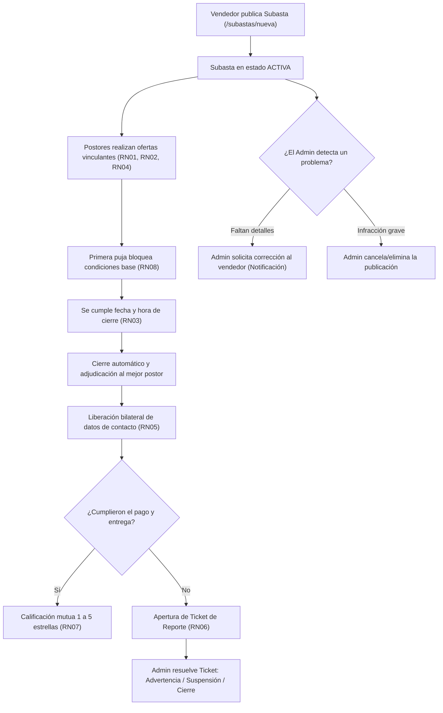

# BidZone — Plataforma de Subastas Online en Tiempo Real

**BidZone** es una plataforma web full-stack de subastas en línea orientada a la compra y venta de artículos mediante **pujas competitivas en tiempo real**. El sistema integra un motor de ofertas vinculantes en vivo, cierre y adjudicación automatizados por vencimiento de tiempo, liberación condicional de datos de contacto entre vendedor y comprador ganador, recuperación de contraseña por correo electrónico con **Nodemailer**, gráficos de métricas para administradores, tickets de moderación e infracciones, y un esquema de reputación verificable.

---

## 📋 Tabla de Contenidos

1. [Descripción General y Propósito](#-1-descripción-general-y-propósito)
2. [Integrantes (Grupo 8)](#-2-integrantes-grupo-8)
3. [Reglas de Negocio (RN01 – RN08)](#-3-reglas-de-negocio-rn01--rn08)
4. [Roles de Usuario y Matriz de Permisos](#-4-roles-de-usuario-y-matriz-de-permisos)
5. [Flujos Principales del Sistema](#-5-flujos-principales-del-sistema)
6. [Arquitectura General y Estructura del Proyecto](#️-6-arquitectura-general-y-estructura-del-proyecto)
7. [Modelo de Datos Relacional (MySQL 8.0+)](#️-7-modelo-de-datos-relacional-mysql-80)
8. [Endpoints de la API REST (Backend)](#-8-endpoints-de-la-api-rest-backend)
9. [Mapa de Rutas y Vistas CRUD (Frontend)](#-9-mapa-de-rutas-y-vistas-crud-frontend)
10. [Sistema de Diseño y Convenciones de Código](#-10-sistema-de-diseño-y-convenciones-de-código)
11. [Stack Tecnológico](#️-11-stack-tecnológico)
12. [Instalación y Puesta en Marcha Paso a Paso](#️-12-instalación-y-puesta-en-marcha-paso-a-paso)
13. [Recuperación de Contraseña por Correo (Nodemailer)](#-13-recuperación-de-contraseña-por-correo-nodemailer)
14. [Cuentas de Prueba (Datos Semilla)](#-14-cuentas-de-prueba-datos-semilla)
15. [Scripts Disponibles](#-15-scripts-disponibles)

---

## 📖 1. Descripción General y Propósito

En las compraventas informales a través de redes sociales o foros tradicionales suelen ocurrir disputas frecuentes: falta de transparencia sobre quién ofertó primero, ofertas falsas o retractaciones sin consecuencias, cambios arbitrarios de precio por parte del vendedor y exposición pública innecesaria de teléfonos o correos personales.

**BidZone** resuelve esta problemática mediante cinco pilares:

1. **Transparencia Total en Sala:** Historial cronológico de ofertas auditable y visible para todos los participantes, con actualización en tiempo real del postor líder y galería de hasta 4 imágenes por artículo.
2. **Adjudicación Imparcial por Tiempo:** Las subastas solo se adjudican cuando se cumple estrictamente su fecha y hora de cierre (`fechaFin`). Ni el vendedor ni un administrador pueden forzar una adjudicación anticipada.
3. **Privacidad y Liberación Condicional de Contacto (RN05):** Los datos personales (`correo`, `telefono`) del vendedor y del comprador permanecen protegidos durante toda la subasta y se desbloquean únicamente entre el vendedor y el postor ganador cuando la subasta finaliza con adjudicación.
4. **Compromiso Vinculante y Moderación por Tickets (RN04 / RN06):** Cada oferta exige aceptar una declaración jurada de compromiso de compra. Si alguna de las partes incumple el pago o la entrega, la contraparte abre un ticket de reporte que un administrador resuelve aplicando advertencias, suspensiones o cierre definitivo de cuenta.
5. **Reputación Basada en Operaciones Reales (RN07):** Solo el vendedor y el ganador de una subasta finalizada pueden calificarse mutuamente (de 1 a 5 estrellas, una única vez por operación), recalculando de forma automática el promedio de reputación del usuario evaluado.

---

## 👥 2. Integrantes (Grupo 8)

- **Mario Matías Moussa**
- **Luciano Medina**
- **Leandro Agustín Quipildor**

**Cátedra:** Análisis, Modelado y Diseño de Sistemas

---

## ⚖️ 3. Reglas de Negocio (RN01 – RN08)

Las siguientes reglas de negocio están implementadas y validadas en las **tres capas** del sistema (interfaz React, controladores Express y restricciones SQL en MySQL):

| Código | Regla | Descripción Funcional | Implementación Técnica |
| :--- | :--- | :--- | :--- |
| **RN01** | **Incremento Mínimo** | Toda nueva puja debe ser mayor o igual al precio actual más el incremento mínimo (`precioActual + incrementoMinimo`). Además, se aplica un tope preventivo anti-errores de tipeo (`10x` el precio inicial). | Validado en `validarDatosPuja` (frontend) y dentro de la transacción SQL `crearPuja` en `puja.controller.js` (backend). |
| **RN02** | **Prohibición de Auto-puja** | El vendedor titular de una subasta no puede ofertar sobre su propio artículo. | Bloqueo visual del formulario en `PanelPujasSubasta.jsx` y rechazo HTTP `400` en `puja.controller.js`. |
| **RN03** | **Vigencia Temporal** | Solo se admiten ofertas mientras la subasta esté `activa` y su fecha de cierre (`fechaFin`) sea futura. Al cumplirse el plazo, el sistema cierra la subasta y asigna `ganadorId` al mejor postor. | Sincronización automática en `cerrarSubastasVencidas()` antes de listar, consultar o pujar. |
| **RN04** | **Irrevocabilidad de Pujas** | Las ofertas enviadas son vinculantes: un postor no puede eliminar su puja ni reducir el monto ofertado. Únicamente puede editar su nota de coordinación (`nota`). | `VistaEditarPuja.jsx` y `PUT /api/pujas/:id` permiten modificar solo la nota para el postor titular. |
| **RN05** | **Liberación Condicional de Datos** | El teléfono y correo electrónico de las partes se mantienen ocultos y solo se revelan al vendedor y al ganador cuando la subasta está `finalizada` con ganador adjudicado. | `subasta.controller.js` incluye `correo` y `telefono` de vendedor y ganador solo si el usuario autenticado es parte de la operación finalizada. |
| **RN06** | **Régimen de Infracciones** | Ante incumplimientos de pago, entrega o artículos engañosos, se emite un ticket de reporte. El administrador dictamina la resolución y puede mantener la cuenta activa, suspenderla (`suspendida`) o cerrarla definitivamente (`cerrada`). | `PanelResolucionTicket.jsx` y `PATCH /api/reportes/:id` actualizan el reporte, el estado del usuario en `usuarios` y emiten notificación oficial. |
| **RN07** | **Calificación Mutua Única** | Solo vendedor y ganador de una subasta `finalizada` pueden calificarse mutuamente (1 a 5 estrellas) y como máximo **una vez por subasta y autor**. | Restricción `UNIQUE (subasta_id, autor_id)` en MySQL, validación en `resena.controller.js` y recálculo automático de `usuarios.reputacion`. |
| **RN08** | **Inmutabilidad por Oferta** | Una vez que una subasta recibe su primera puja (`cantidadPujas > 0`), el vendedor ya no puede modificar el precio base, el incremento mínimo ni la fecha de cierre (solo descripción o imágenes para aclaraciones). | Campos bloqueados en `FormularioSubasta.jsx` (`tienePujas`) y protegidos en `PUT /api/subastas/:id`. |

---

## 🔐 4. Roles de Usuario y Matriz de Permisos

El sistema distingue tres niveles de acceso:

### 1. Visitante (No autenticado)
- Puede explorar el catálogo de subastas (`/subastas`), filtrar por categoría, buscar por palabras clave, usar los filtros rápidos (`Activas`, `Termina Hoy`, `Termina Mañana`, `Finalizadas`, `Todas`) y ver el detalle completo e historial de pujas de cualquier subasta (`/subastas/:id`).
- Puede consultar los reglamentos (`/reglamentos`) y preguntas frecuentes (`/preguntas-frecuentes`).
- Si intenta ofertar o acceder a una ruta privada, es redirigido a `/iniciar-sesion`.

### 2. Usuario Registrado (`rol: 'usuario'`)
- **Publicar y gestionar sus subastas:** Puede crear nuevas subastas (`/subastas/nueva`, con hasta 4 imágenes), editar sus propias publicaciones (`/subastas/:id/editar`, respetando **RN08**) y eliminarlas si aún no tienen pujas comprometidas.
- **Pujar en vivo:** Puede ofertar en subastas de terceros y editar la nota de coordinación de sus propias pujas (`/pujas/:id/editar`).
- **Liberación de contacto y cierres:** En su panel ve la sección *"Cierres Adjudicados y Contacto Liberado (RN05)"* únicamente para las subastas donde resultó vendedor o comprador ganador, con recordatorio del plazo de coordinación de 48 hs.
- **Reportes y Calificaciones:** Puede abrir tickets de reporte (`/reportes/nuevo`) sobre subastas adjudicadas en las que participó y calificar a su contraparte (`/resenas/nueva`).
- **Privacidad en su Panel:** Solo visualiza sus propias subastas, sus propias pujas, sus propios reportes, sus propias reseñas y sus propias notificaciones.

### 3. Administrador / Moderador (`rol: 'admin'`)
- **Panel de Métricas y Gráficos:** En el resumen del panel (`/panel`) accede a `GraficosAdminPanel.jsx` con 4 gráficos en tiempo real sobre estado de subastas, distribución por categorías, reportes y estado de cuentas.
- **Moderación del Catálogo de Subastas:**
  - En el catálogo y en la pestaña **Subastas** del Panel puede inspeccionar todas las publicaciones de la plataforma (paginadas de a 20 por página).
  - **No edita directamente publicaciones ajenas ni puede finalizar/adjudicar subastas antes de tiempo:** si detecta un artículo con datos incompletos o confusos, utiliza el **Panel de Solicitud de Corrección** (`PanelSolicitudCorreccion.jsx`), que envía una notificación oficial al vendedor indicando qué debe corregir.
  - Si una publicación viola las normas, puede **cancelarla o darla de baja** (`DELETE /api/subastas/:id`).
- **Sistema de Tickets de Reportes (RN06):**
  - En la pestaña **Reportes** visualiza todos los tickets de denuncia abiertos por la comunidad y los resuelve desde `PanelResolucionTicket.jsx`:
    1. *Desestimar reclamo (`desestimado`, sin sanción).*
    2. *Resolver con advertencia formal.*
    3. *Suspender cuenta temporalmente (`suspendida`).*
    4. *Cerrar cuenta definitivamente (`cerrada`).*
- **Gestión de Usuarios (`/usuarios`):**
  - Acceso exclusivo a la pestaña y vistas de administración de cuentas (`/usuarios`, `/usuarios/nuevo`, `/usuarios/:id/editar`) para auditar estados disciplinarios y roles.
- **Actividad Personal Separada:**
  - En las pestañas **Mis Pujas**, **Mis Reseñas** y **Notificaciones**, el administrador ve únicamente su propia actividad personal.

---

## 🔄 5. Flujos Principales del Sistema



---

## 🏗️ 6. Arquitectura General y Estructura del Proyecto

El proyecto está organizado en **dos repositorios/directorios hermanos** (`backend/` y `BidZone/`), ambos escritos **100% en español** (tablas SQL, rutas HTTP, claves JSON, modelos, controladores, tiendas de estado y componentes):

```text
Proyectos/BidZone/
├── backend/                                      # API REST (Node.js + Express + MySQL2 + Nodemailer)
│   ├── .env.example                              # Plantilla de variables de entorno (MySQL, JWT y SMTP)
│   ├── README.md                                 # Guía paso a paso específica del servidor
│   ├── database/                                 # Capa de persistencia relacional (MySQL 8.0+)
│   │   ├── schema.sql                            # DDL: 6 tablas, PK, FK, UNIQUE, CHECK e índices
│   │   └── seed.sql                              # Datos semilla: 25 usuarios (3 admins) y 50 subastas
│   ├── src/
│   │   ├── servidor.js                           # Punto de entrada: verifica MySQL y levanta Express
│   │   ├── app.js                                # Configuración de Express, CORS, JSON y errores
│   │   ├── config/
│   │   │   ├── entorno.js                        # Carga y validación de variables de entorno (.env)
│   │   │   └── baseDatos.js                      # Pool de conexiones MySQL2 y chequeo de salud
│   │   ├── baseDatos/
│   │   │   ├── inicializarBd.js                  # Script ejecutable para npm run db:init
│   │   │   └── sembrarBd.js                      # Script ejecutable para npm run db:seed
│   │   ├── utilidades/
│   │   │   ├── correo.js                         # Envío de códigos de recuperación con Nodemailer
│   │   │   ├── fecha.js                          # Conversión y formateo de fechas MySQL/ISO
│   │   │   └── token.js                          # Firma y verificación de JWT
│   │   ├── middlewares/
│   │   │   ├── autenticacion.middleware.js       # Verificación de JWT, roles (RBAC) y bloqueo de cuentas
│   │   │   ├── validar.middleware.js             # Validación de IDs numéricos y parámetros
│   │   │   └── errores.middleware.js             # Manejo centralizado de errores HTTP y SQL
│   │   ├── rutas/                                # Definición de endpoints REST bajo /api/*
│   │   │   ├── index.js                          # /api/salud y montaje de los 7 módulos
│   │   │   ├── autenticacion.routes.js
│   │   │   ├── usuario.routes.js
│   │   │   ├── subasta.routes.js
│   │   │   ├── puja.routes.js
│   │   │   ├── reporte.routes.js
│   │   │   ├── resena.routes.js
│   │   │   └── notificacion.routes.js
│   │   ├── controladores/                        # Lógica de negocio (RN01 a RN08)
│   │   │   ├── autenticacion.controller.js       # Registro, login, perfil y recuperación por correo
│   │   │   ├── usuario.controller.js
│   │   │   ├── subasta.controller.js
│   │   │   ├── puja.controller.js
│   │   │   ├── reporte.controller.js
│   │   │   ├── resena.controller.js
│   │   │   └── notificacion.controller.js
│   │   └── modelos/                              # Consultas SQL parametrizadas por entidad
│   │       ├── usuario.model.js
│   │       ├── subasta.model.js
│   │       ├── puja.model.js
│   │       ├── reporte.model.js
│   │       ├── resena.model.js
│   │       └── notificacion.model.js
│   └── tests/
│       └── api.test.js                           # Suite de pruebas automatizadas del backend
│
└── BidZone/                                      # Aplicación Frontend (React 19 + Vite + Tailwind v4 + Zustand)
    ├── .env.example                              # Configuración de VITE_API_URL
    └── src/
        ├── modulos/
        │   ├── nucleo/                           # Núcleo compartido de la aplicación
        │   │   ├── componentes/                  # Layout, Navbar, Footer, Inicio, RutaProtegida, VistaPanelControl, VistaError404
        │   │   │   └── panel/                    # Pestañas del Panel (Resumen + GraficosAdminPanel, Subastas, Pujas, Reportes, Reseñas, Usuarios, Notificaciones, Perfil)
        │   │   ├── diseno/                       # Sistema de diseño (ui.jsx, uiFeedback.jsx, componentesBloques.jsx)
        │   │   ├── servicios/                    # Cliente HTTP centralizado con JWT (clienteApi.js)
        │   │   └── utilidades/                   # Formateadores de moneda/fechas y ayudas (formatos.js, ayudas.js)
        │   ├── autenticacion/                    # Login, Recuperar Contraseña, Registro, CRUD Usuarios y tiendaAutenticacion.js
        │   ├── subastas/                         # Catálogo paginado, TarjetaSubasta, Galería (hasta 4 fotos), Detalle en vivo, Crear/Editar y Solicitud de Corrección
        │   ├── pujas/                            # Crear/Editar pujas, confirmación vinculante y tiendaPujas.js
        │   ├── reportes/                         # Crear/Editar reportes, PanelResolucionTicket y tiendaReportes.js
        │   ├── resenas/                          # Crear/Editar reseñas con estrellas y tiendaResenas.js
        │   └── notificaciones/                   # Bandeja personal y tiendaNotificaciones.js
        ├── App.jsx                               # Enrutador principal con rutas públicas y protegidas
        └── main.jsx                              # Punto de montaje de React
```

---

## 🗄️ 7. Modelo de Datos Relacional (MySQL 8.0+)

El esquema (`../backend/database/schema.sql`) está normalizado en **3FN** y compuesto por **6 tablas relacionales** con integridad referencial (`FOREIGN KEY`) y restricciones de dominio (`CHECK` y `ENUM`):

1. **`usuarios`**:
   - Campos clave: `id`, `nombre`, `correo` (`UNIQUE`), `contrasena_hash`, `rol` (`'usuario' | 'admin'`), `estado` (`'activa' | 'suspendida' | 'cerrada'`), `reputacion` (`1.00` a `5.00`), `telefono`, `ciudad`.
2. **`subastas`**:
   - Campos clave: `id`, `titulo`, `descripcion`, `categoria`, `url_imagen`, `precio_base`, `precio_actual`, `incremento_minimo`, `fecha_fin`, `estado` (`'activa' | 'finalizada' | 'cancelada'`), `vendedor_id` (`FK -> usuarios.id`), `ganador_id` (`FK -> usuarios.id`, nullable).
   - Restricciones: `precio_base > 0`, `precio_actual >= precio_base`, `incremento_minimo > 0`.
3. **`pujas`**:
   - Campos clave: `id`, `subasta_id` (`FK -> subastas.id ON DELETE CASCADE`), `postor_id` (`FK -> usuarios.id`), `monto`, `nota`, `compromiso_aceptado` (`TINYINT(1)`).
   - Restricciones: `monto > 0`, `compromiso_aceptado = 1` (**RN04**).
4. **`reportes`**:
   - Campos clave: `id`, `subasta_id` (`FK -> subastas.id`), `denunciante_id` (`FK -> usuarios.id`), `denunciado_id` (`FK -> usuarios.id`), `motivo`, `descripcion`, `url_evidencia`, `estado` (`'en_revision' | 'resuelto_sancion' | 'desestimado'`), `sancion_aplicada`.
   - Restricción: `denunciante_id <> denunciado_id`.
5. **`resenas`**:
   - Campos clave: `id`, `subasta_id` (`FK -> subastas.id`), `autor_id` (`FK -> usuarios.id`), `calificado_id` (`FK -> usuarios.id`), `puntaje` (`1` a `5`), `comentario`, `contexto_rol` (`'comprador_a_vendedor' | 'vendedor_a_comprador'`).
   - Restricciones: `UNIQUE (subasta_id, autor_id)` (**RN07**) y `autor_id <> calificado_id`.
6. **`notificaciones`**:
   - Campos clave: `id`, `usuario_id` (`FK -> usuarios.id ON DELETE CASCADE`), `subasta_id` (`FK -> subastas.id ON DELETE SET NULL`), `tipo` (`'superada' | 'ganada' | 'cerrada' | 'reporte' | 'sistema'`), `titulo`, `mensaje`, `leida`.

---

## 🔌 8. Endpoints de la API REST (Backend)

Todos los endpoints se sirven desde `../backend` bajo el prefijo `/api`:

| Módulo | Método y Ruta | Acceso | Descripción |
| :--- | :--- | :--- | :--- |
| **Salud** | `GET /api/salud` | Público | Verifica el estado del servidor Express y la conexión activa con MySQL. |
| **Autenticación** | `POST /api/autenticacion/registrar` | Público | Registra un nuevo usuario, hashea su contraseña con `bcryptjs` y devuelve JWT. |
| **Autenticación** | `POST /api/autenticacion/iniciar-sesion` | Público | Autentica credenciales, verifica que la cuenta no esté cerrada/suspendida y emite JWT. |
| **Autenticación** | `POST /api/autenticacion/solicitar-recuperacion` | Público | Genera un código de 6 dígitos (vigente 15 min) y lo envía por correo con Nodemailer. |
| **Autenticación** | `POST /api/autenticacion/restablecer-contrasena` | Público | Valida el código de recuperación y ejecuta el `UPDATE` de la nueva contraseña en MySQL. |
| **Autenticación** | `GET /api/autenticacion/perfil` | Autenticado | Devuelve el perfil actualizado del usuario en sesión a partir de su token JWT. |
| **Usuarios** | `GET /api/usuarios` | Autenticado | Lista usuarios (datos públicos para usuarios comunes; padrón completo para admin). |
| **Usuarios** | `GET /api/usuarios/:id` | Autenticado | Obtiene el detalle de un usuario específico. |
| **Usuarios** | `POST /api/usuarios` | Solo Admin | Crea una nueva cuenta de usuario con rol y estado configurables. |
| **Usuarios** | `PUT / PATCH /api/usuarios/:id` | Dueño / Admin | Actualiza datos de contacto (o rol/estado disciplinario si es administrador). |
| **Usuarios** | `DELETE /api/usuarios/:id` | Solo Admin | Elimina un usuario sin operaciones comprometidas. |
| **Subastas** | `GET /api/subastas` | Público / Token | Sincroniza cierres vencidos (**RN03**) y lista todas las subastas con conteo de pujas. |
| **Subastas** | `GET /api/subastas/:id` | Público / Token | Detalle de subasta, historial de pujas y contacto liberado si corresponde (**RN05**). |
| **Subastas** | `POST /api/subastas` | Autenticado | Publica una nueva subasta activa validando precios y fecha futura. |
| **Subastas** | `PUT / PATCH /api/subastas/:id` | Vendedor / Admin | Edita una subasta respetando el bloqueo de condiciones con pujas (**RN08**). |
| **Subastas** | `DELETE /api/subastas/:id` | Vendedor / Admin | Da de baja una subasta sin pujas (o cancelación por moderación administrativa). |
| **Pujas** | `GET /api/pujas` | Autenticado | Lista las pujas registradas (propias o todas según contexto). |
| **Pujas** | `GET /api/pujas/:id` | Autenticado | Obtiene el detalle de una puja específica. |
| **Pujas** | `POST /api/pujas` | Autenticado | Registra una puja vinculante en transacción SQL (**RN01–RN04**) y notifica al postor superado. |
| **Pujas** | `PUT / PATCH /api/pujas/:id` | Postor Titular | Actualiza únicamente la nota de coordinación de la oferta (**RN04**). |
| **Pujas** | `DELETE /api/pujas/:id` | Solo Admin | Eliminación excepcional por moderación administrativa. |
| **Reportes** | `GET /api/reportes` | Autenticado | Lista los reportes propios del usuario (o todos los tickets si es administrador). |
| **Reportes** | `GET /api/reportes/:id` | Autenticado | Obtiene el detalle de un ticket de reporte. |
| **Reportes** | `POST /api/reportes` | Autenticado | Crea un ticket de denuncia sobre una operación adjudicada (**RN06**). |
| **Reportes** | `PUT / PATCH /api/reportes/:id` | Denunciante / Admin | Actualiza evidencia (denunciante) o aplica dictamen y sanción de cuenta (admin). |
| **Reportes** | `DELETE /api/reportes/:id` | Solo Admin | Elimina un reporte por moderación. |
| **Reseñas** | `GET /api/resenas` | Autenticado | Lista las calificaciones registradas. |
| **Reseñas** | `GET /api/resenas/:id` | Autenticado | Obtiene el detalle de una reseña. |
| **Reseñas** | `POST /api/resenas` | Autenticado | Registra una calificación post-cierre (**RN07**) y recalcula `usuarios.reputacion`. |
| **Reseñas** | `PUT / PATCH /api/resenas/:id` | Autor Reseña | Edita la puntuación o comentario de una reseña propia y recalcula reputación. |
| **Reseñas** | `DELETE /api/resenas/:id` | Autor / Admin | Elimina una reseña y actualiza el promedio de reputación del usuario evaluado. |
| **Notificaciones** | `GET /api/notificaciones` | Autenticado | Obtiene la bandeja personal de notificaciones del usuario en sesión. |
| **Notificaciones** | `POST /api/notificaciones` | Solo Admin | Envía un aviso oficial o solicitud de corrección de subasta a un vendedor. |
| **Notificaciones** | `PATCH /api/notificaciones/:id/leida` | Autenticado | Marca una notificación individual como leída. |
| **Notificaciones** | `PATCH /api/notificaciones/leer-todas` | Autenticado | Marca todas las notificaciones del usuario como leídas. |
| **Notificaciones** | `DELETE /api/notificaciones/:id` | Autenticado | Elimina una notificación de la bandeja personal. |

---

## 🧭 9. Mapa de Rutas y Vistas CRUD (Frontend)

La aplicación cuenta con más de **15 vistas CRUD completas** distribuidas en las 5 entidades principales (`Subastas`, `Pujas`, `Reportes`, `Reseñas` y `Usuarios`), con rutas principales en español y redirecciones automáticas desde las rutas anteriores en inglés:

### Vistas CRUD por Entidad

| Entidad | Vista de Listado | Vista de Creación | Vista de Edición | Vista de Detalle |
| :--- | :--- | :--- | :--- | :--- |
| **1. Subastas** | `/subastas` (`VistaListaSubastas`) y `/panel?tab=subastas` | `/subastas/nueva` (`VistaCrearSubasta`) | `/subastas/:id/editar` (`VistaEditarSubasta`) | `/subastas/:id` (`VistaDetalleSubasta`) |
| **2. Pujas** | `/pujas` (`TabPujasPanel`) | `/pujas/nueva` (`VistaCrearPuja`) | `/pujas/:id/editar` (`VistaEditarPuja`) | Historial integrado en `/subastas/:id` |
| **3. Reportes** | `/reportes` (`TabReportesPanel`) | `/reportes/nuevo` (`VistaCrearReporte`) | `/reportes/:id/editar` (`VistaEditarReporte`) | Expediente integrado en tarjeta y edición |
| **4. Reseñas** | `/resenas` (`TabResenasPanel`) | `/resenas/nueva` (`VistaCrearResena`) | `/resenas/:id/editar` (`VistaEditarResena`) | Tarjeta con estrellas y contexto de rol |
| **5. Usuarios** | `/usuarios` (`TabUsuariosPanel`, Admin) | `/usuarios/nuevo` (`VistaCrearUsuario`, Admin) | `/usuarios/:id/editar` (`VistaEditarUsuario`) | `/panel?tab=perfil` (`TabPerfilPanel`) |

### Vistas Públicas y de Sistema
- `/` — **Inicio** (`Inicio.jsx`): Portada con buscador rápido, métricas en vivo, catálogo filtrado por categoría y accesos directos.
- `/iniciar-sesion` (alias `/login`) — **Iniciar Sesión** (`VistaIniciarSesion.jsx`): Autenticación JWT y flujo de recuperación de contraseña por correo (`FormularioRecuperarContrasena.jsx`).
- `/registro` (alias `/register`) — **Crear Cuenta** (`VistaRegistro.jsx`): Registro de nuevos usuarios con validación de campos.
- `/panel` (alias `/dashboard`) — **Panel de Control** (`VistaPanelControl.jsx`): Resumen, gráficos de administración (`GraficosAdminPanel.jsx`), subastas, pujas, reportes, reseñas, usuarios, notificaciones y perfil.
- `/reglamentos` (alias `/rules`) — **Reglamentos** (`VistaReglamentos.jsx`): Explicación detallada de las reglas RN01 a RN08.
- `/preguntas-frecuentes` (alias `/faq`) — **Preguntas Frecuentes** (`VistaPreguntasFrecuentes.jsx`).
- `/notificaciones` (alias `/notifications`) — **Centro de Notificaciones** (`TabNotificacionesPanel.jsx`).
- `/404` y comodín `*` — **Error 404** (`VistaError404.jsx`).

---

## 🎨 10. Sistema de Diseño y Convenciones de Código

El frontend fue diseñado y auditado priorizando **claridad, reutilización de componentes y bajo acoplamiento**:

- **Paleta Visual BidZone:** Contraste editorial moderno basado en verde lima claro (`#EAFFD0`), verde bosque profundo (`#224F10`) y negro carbón (`#0D0D0D`).
- **Componentes Base Reutilizables (`src/modulos/nucleo/diseno/`):**
  - `ui.jsx`: `Button`, `Input`, `Textarea`, `Select`, `Badge`, `Card`.
  - `uiFeedback.jsx`: `Alert`, `Modal`, `EmptyState`, `Loading`, `ErrorCard`, `StarRating`.
  - `componentesBloques.jsx`: `CabeceraPagina`, `PaginaFormulario`, `AccionesFormulario`, `CampoFormulario`, `FiltrosBotones`, `TarjetaEstadistica`, `TarjetaCtaCatalogo`.
- **Unificación de Componentes:**
  - Una sola `TarjetaSubasta.jsx` sirve a Inicio, Explorar y el Panel.
  - Un solo `FormularioUsuario.jsx` sirve tanto para el perfil personal como para la administración de usuarios.
  - Un solo reloj por pantalla (`useRelojSegundo` en `ayudas.js`) sincroniza todas las cuentas regresivas sin duplicar temporizadores.
- **Calidad Estática:** El linter (`oxlint`) valida los 81 archivos fuente con **0 advertencias y 0 errores**.

---

## 🛠️ 11. Stack Tecnológico

- **Frontend (`BidZone/`):**
  - **React 19** + **Vite 8**
  - **Tailwind CSS v4** (`@tailwindcss/vite`)
  - **React Router DOM v7** (enrutamiento declarativo y rutas protegidas por rol)
  - **Zustand v5** (tiendas de estado globales sincronizadas con la API REST)
  - **Lucide React** (iconografía consistente)
  - **Oxlint** (análisis estático ultrarrápido)
- **Backend (`../backend/`):**
  - **Node.js (ES Modules)** + **Express 4**
  - **MySQL2 (`mysql2/promise`)** con pool de conexiones y transacciones explícitas (`BEGIN` / `COMMIT` / `ROLLBACK`)
  - **JSON Web Tokens (`jsonwebtoken`)** para autenticación stateless
  - **BcryptJS (`bcryptjs`)** para hash seguro de contraseñas
  - **Nodemailer (`nodemailer`)** para envío de códigos de recuperación de contraseña
- **Base de Datos:**
  - **MySQL 8.0+**

---

## ⚙️ 12. Instalación y Puesta en Marcha Paso a Paso

### Paso 1: Requisitos Previos
- **Node.js** `v18+` y `npm`.
- **MySQL Server** `8.0+` ejecutándose localmente (por ejemplo en el puerto `3306`, mediante MySQL Server, XAMPP o Laragon).

### Paso 2: Configurar e Iniciar el Backend y la Base de Datos (`../backend`)

1. Abre una terminal y entra en la carpeta `backend`:
   ```bash
   cd ../backend
   npm install
   ```
2. Crea un archivo `.env` en `backend/.env` tomando como base `backend/.env.example`:
   ```env
   PORT=3000
   NODE_ENV=development
   CORS_ORIGIN=http://localhost:5173

   JWT_SECRET=clave_secreta_muy_larga_para_bidzone_2026
   JWT_EXPIRES_IN=8h
   BCRYPT_SALT_ROUNDS=10

   DB_HOST=localhost
   DB_PORT=3306
   DB_USER=root
   DB_PASSWORD=tu_password_mysql
   DB_NAME=bidzone_db
   ```
3. Crea la base de datos `bidzone_db` con sus 6 tablas (`backend/database/schema.sql`) y carga los datos de prueba (`backend/database/seed.sql`):
   ```bash
   npm run db:init
   npm run db:seed
   ```
4. Levanta el servidor Express:
   ```bash
   npm run dev
   ```
   El backend quedará disponible en `http://localhost:3000/api` (puedes verificarlo abriendo `http://localhost:3000/api/salud`).

### Paso 3: Configurar e Iniciar el Frontend (`BidZone`)

1. Abre otra terminal en la carpeta `BidZone` (este directorio):
   ```bash
   npm install
   ```
2. *(Opcional)* Si cambiaste el puerto del backend, crea un archivo `.env` a partir de `.env.example` con:
   ```env
   VITE_API_URL=http://localhost:3000/api
   ```
3. Inicia el servidor de desarrollo de Vite:
   ```bash
   npm run dev
   ```
4. Abre `http://localhost:5173` en tu navegador.

---

## 📧 13. Recuperación de Contraseña por Correo (Nodemailer)

Desde `/iniciar-sesion` el usuario puede solicitar un código de verificación de **6 dígitos** (válido por 15 minutos) para restablecer su contraseña mediante un `UPDATE` en MySQL:

- **Modo Prueba Automático (sin configurar SMTP):** Si las variables `SMTP_*` se dejan vacías en `backend/.env`, `src/utilidades/correo.js` crea automáticamente una cuenta temporal en **Ethereal Email** e imprime en la consola del backend la URL de vista previa del correo enviado.
- **Modo Correo Real (ej. Gmail):** Completa las siguientes variables en `backend/.env` usando una *Contraseña de aplicación*:
  ```env
  SMTP_HOST=smtp.gmail.com
  SMTP_PORT=587
  SMTP_USER=tu_correo@gmail.com
  SMTP_PASS=tu_contrasena_de_aplicacion
  SMTP_FROM="BidZone <tu_correo@gmail.com>"
  ```

---

## 🧪 14. Cuentas de Prueba (Datos Semilla)

Al ejecutar `npm run db:seed` en `../backend`, se cargan **25 usuarios** (3 administradores, 20 usuarios activos, 1 cuenta suspendida y 1 cuenta cerrada) y **50 subastas** con imágenes reales, pujas, reportes, reseñas y notificaciones.

Puedes iniciar sesión desde `/iniciar-sesion` con cualquiera de las siguientes cuentas:

| Rol | Nombre | Correo Electrónico | Contraseña | Estado |
| :--- | :--- | :--- | :--- | :--- |
| **Administrador** | Leandro Quipildor | `leandroadmin@bidzone.com` | `leandroadmin` | Activa |
| **Administrador** | Mario Matías Moussa | `marioadmin@bidzone.com` | `marioadmin` | Activa |
| **Administrador** | Luciano Medina | `lucianoadmin@bidzone.com` | `lucianoadmin` | Activa |
| **Usuario (x20)** | Sofía, Tomás, Camila, etc. | `sofia@bidzone.com`, `tomas@bidzone.com`, `camila@bidzone.com`, ... | `user123` | Activa |
| **Usuario (prueba RN06)** | Valentina | `valentina@correo.com` | `user123` | Suspendida |
| **Usuario (prueba RN06)** | Damián | `damian@correo.com` | `user123` | Cerrada |

---

## 📜 15. Scripts Disponibles

### En `BidZone/` (Frontend)
| Comando | Descripción |
| :--- | :--- |
| `npm run dev` | Inicia el servidor de desarrollo Vite en `http://localhost:5173`. |
| `npm run build` | Genera el paquete optimizado de producción en la carpeta `dist/`. |
| `npm run lint` | Ejecuta el linter `oxlint` sobre los 81 archivos fuente del proyecto. |
| `npm run preview` | Sirve localmente la compilación de producción. |

### En `../backend/` (Backend y Base de Datos)
| Comando | Descripción |
| :--- | :--- |
| `npm run dev` | Inicia la API REST con recarga automática (`node --watch src/servidor.js`). |
| `npm start` | Inicia la API REST en modo producción (`node src/servidor.js`). |
| `npm run db:init` | Ejecuta `backend/database/schema.sql` para crear la base `bidzone_db` y sus 6 tablas. |
| `npm run db:seed` | Ejecuta `backend/database/seed.sql` cargando los 25 usuarios (3 admins) y 50 subastas. |
| `npm test` | Ejecuta la suite de pruebas automatizadas del backend (`node --test tests/api.test.js`). |
