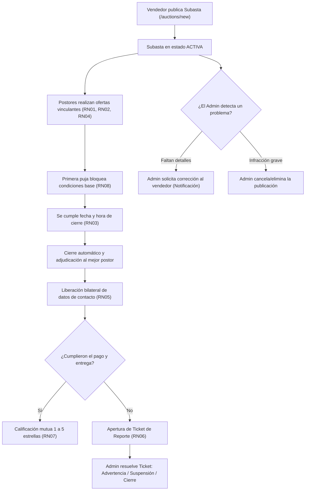

# BidZone — Plataforma de Subastas Online en Tiempo Real

**BidZone** es una plataforma web full-stack de subastas en línea orientada a la compra y venta de artículos mediante **pujas competitivas en tiempo real**. El sistema integra un motor de ofertas vinculantes en vivo, cierre y adjudicación automatizados por vencimiento de tiempo, liberación condicional de datos de contacto entre vendedor y comprador ganador, un sistema de tickets de moderación e infracciones, y un esquema de reputación verificable.

---

## 📋 Tabla de Contenidos

1. [Descripción General y Propósito](#-1-descripción-general-y-propósito)
2. [Integrantes (Grupo 8)](#-2-integrantes-grupo-8)
3. [Reglas de Negocio (RN01 – RN08)](#-3-reglas-de-negocio-rn01--rn08)
4. [Roles de Usuario y Matriz de Permisos](#-4-roles-de-usuario-y-matriz-de-permisos)
5. [Flujos Principales del Sistema](#-5-flujos-principales-del-sistema)
6. [Arquitectura General y Estructura del Proyecto](#️-6-arquitectura-general-y-estructura-del-proyecto)
7. [Modelo de Datos Relacional (MySQL 8.0+)](#️-7-modelo-de-datos-relacional-mysql-80)
8. [Endpoints de la API REST (Backend)](#-8-endpoints-de-la-api-rest-backend)
9. [Mapa de Rutas y Vistas CRUD (Frontend)](#-9-mapa-de-rutas-y-vistas-crud-frontend)
10. [Sistema de Diseño y Convenciones de Código](#-10-sistema-de-diseño-y-convenciones-de-código)
11. [Stack Tecnológico](#️-11-stack-tecnológico)
12. [Instalación y Puesta en Marcha Paso a Paso](#️-12-instalación-y-puesta-en-marcha-paso-a-paso)
13. [Cuentas de Prueba (Datos Semilla)](#-13-cuentas-de-prueba-datos-semilla)
14. [Scripts Disponibles](#-14-scripts-disponibles)

---

## 📖 1. Descripción General y Propósito

En las compraventas informales a través de redes sociales o foros tradicionales suelen ocurrir disputas frecuentes: falta de transparencia sobre quién ofertó primero, ofertas falsas o retractaciones sin consecuencias, cambios arbitrarios de precio por parte del vendedor y exposición pública innecesaria de teléfonos o correos personales.

**BidZone** resuelve esta problemática mediante cinco pilares:

1. **Transparencia Total en Sala:** Historial cronológico de ofertas auditable y visible para todos los participantes, con actualización en tiempo real del postor líder.
2. **Adjudicación Imparcial por Tiempo:** Las subastas solo se adjudican cuando se cumple estrictamente su fecha y hora de cierre (`endTime`). Ni el vendedor ni un administrador pueden forzar una adjudicación anticipada.
3. **Privacidad y Liberación Condicional de Contacto (RN05):** Los datos personales (`email`, `phone`, `city`) del vendedor y del comprador permanecen protegidos durante toda la subasta y se desbloquean únicamente entre el vendedor y el postor ganador cuando la subasta finaliza con adjudicación.
4. **Compromiso Vinculante y Moderación por Tickets (RN04 / RN06):** Cada oferta exige aceptar una declaración jurada de compromiso de compra. Si alguna de las partes incumple el pago o la entrega, la contraparte abre un ticket de reporte que un administrador resuelve aplicando advertencias, suspensiones o cierre definitivo de cuenta.
5. **Reputación Basada en Operaciones Reales (RN07):** Solo el vendedor y el ganador de una subasta finalizada pueden calificarse mutuamente (de 1 a 5 estrellas, una única vez por operación), recalculando de forma automática el promedio de reputación del usuario evaluado.

---

## 👥 2. Integrantes (Grupo 8)

- **Mario Matías Moussa**
- **Luciano Medina**
- **Leandro Agustín Quipildor**

**Cátedra:** Análisis, Modelado y Diseño de Sistemas

---

## ⚖️ 3. Reglas de Negocio (RN01 – RN08)

Las siguientes reglas de negocio están implementadas y validadas en las **tres capas** del sistema (interfaz React, controladores Express y restricciones SQL en MySQL):

| Código | Regla | Descripción Funcional | Implementación Técnica |
| :--- | :--- | :--- | :--- |
| **RN01** | **Incremento Mínimo** | Toda nueva puja debe ser mayor o igual al precio actual más el incremento mínimo (`currentPrice + minIncrement`). Además, se aplica un tope preventivo anti-errores de tipeo (`10x` el precio inicial). | Validado en `validarDatosPuja` (frontend) y dentro de la transacción SQL `createBid` (backend). |
| **RN02** | **Prohibición de Auto-puja** | El vendedor titular de una subasta no puede ofertar sobre su propio artículo. | Bloqueo visual del formulario en `PanelPujasSubasta.jsx` y rechazo HTTP `400` en `bidsController.js`. |
| **RN03** | **Vigencia Temporal** | Solo se admiten ofertas mientras la subasta esté `activa` y su fecha de cierre (`endTime`) sea futura. Al cumplirse el plazo, el sistema cierra la subasta y asigna `winnerId` al mejor postor. | Sincronización automática en `syncExpiredAuctions()` antes de listar, consultar o pujar. |
| **RN04** | **Irrevocabilidad de Pujas** | Las ofertas enviadas son vinculantes: un postor no puede eliminar su puja ni reducir el monto ofertado. Únicamente puede editar su nota de coordinación (`note`). | `VistaEditarPuja.jsx` y `PUT /api/bids/:id` permiten modificar solo la nota para el postor titular. |
| **RN05** | **Liberación Condicional de Datos** | El teléfono y correo electrónico de las partes se mantienen ocultos y solo se revelan al vendedor y al ganador cuando la subasta está `finalizada` con ganador adjudicado. | `sanitizeAuctionPrivacy` en `auctionsController.js` filtra `sellerEmail`, `sellerPhone`, `winnerEmail` y `winnerPhone` según el usuario autenticado. |
| **RN06** | **Régimen de Infracciones** | Ante incumplimientos de pago, entrega o artículos engañosos, se emite un ticket de reporte. El administrador dictamina la resolución y puede advertir (`warned`), suspender (`suspended`) o cerrar (`closed`) la cuenta infractora. | `PanelResolucionTicket.jsx` y `PATCH /api/reports/:id` actualizan el reporte, el estado del usuario en `users` y emiten notificación oficial. |
| **RN07** | **Calificación Mutua Única** | Solo vendedor y ganador de una subasta `finalizada` pueden calificarse mutuamente (1 a 5 estrellas) y como máximo **una vez por subasta y autor**. | Restricción `UNIQUE (auction_id, reviewer_id)` en MySQL, validación en `reviewsController.js` y recálculo automático de `users.reputation`. |
| **RN08** | **Inmutabilidad por Oferta** | Una vez que una subasta recibe su primera puja (`bidCount > 0`), el vendedor ya no puede modificar el precio base, el incremento mínimo ni la fecha de cierre (solo descripción o imagen para aclaraciones). | Campos bloqueados en `FormularioSubasta.jsx` (`tienePujas`) y protegidos en `PUT /api/auctions/:id`. |

---

## 🔐 4. Roles de Usuario y Matriz de Permisos

El sistema distingue tres niveles de acceso:

### 1. Visitante (No autenticado)
- Puede explorar el catálogo de subastas (`/auctions`), filtrar por categoría, buscar por palabras clave, usar los filtros rápidos (`Activas`, `Termina Hoy`, `Termina Mañana`, `Finalizadas`, `Todas`) y ver el detalle completo e historial de pujas de cualquier subasta (`/auctions/:id`).
- Puede consultar los reglamentos (`/rules`) y preguntas frecuentes (`/faq`).
- Si intenta ofertar o acceder a una ruta privada, es redirigido a `/login`.

### 2. Usuario Registrado (`role: 'user'`)
- **Publicar y gestionar sus subastas:** Puede crear nuevas subastas (`/auctions/new`), editar sus propias publicaciones (`/auctions/:id/edit`, respetando **RN08**) y eliminarlas si aún no tienen pujas comprometidas.
- **Pujar en vivo:** Puede ofertar en subastas de terceros y editar la nota de coordinación de sus propias pujas (`/bids/:id/edit`).
- **Liberación de contacto y cierres:** En su panel ve la sección *"Cierres Adjudicados y Contacto Liberado (RN05)"* únicamente para las subastas donde resultó vendedor o comprador ganador.
- **Reportes y Calificaciones:** Puede abrir tickets de reporte (`/reports/new`) sobre subastas adjudicadas en las que participó y calificar a su contraparte (`/reviews/new`).
- **Privacidad en su Dashboard:** Solo visualiza sus propias subastas, sus propias pujas, sus propios reportes, sus propias reseñas y sus propias notificaciones.

### 3. Administrador / Moderador (`role: 'admin'`)
- **Moderación del Catálogo de Subastas:**
  - En el catálogo y en la pestaña **Subastas** del Dashboard puede inspeccionar todas las publicaciones de la plataforma (paginadas de a 20 por página).
  - **No edita directamente publicaciones ajenas ni puede finalizar/adjudicar subastas antes de tiempo:** si detecta un artículo con datos incompletos o confusos, utiliza el **Panel de Solicitud de Corrección** (`PanelSolicitudCorreccion.jsx`), que envía una notificación oficial al vendedor indicando qué debe corregir.
  - Si una publicación viola las normas, puede **cancelarla o darla de baja** (`DELETE /api/auctions/:id`).
- **Sistema de Tickets de Reportes (RN06):**
  - En la pestaña **Reportes** visualiza todos los tickets de denuncia abiertos por la comunidad y los resuelve desde `PanelResolucionTicket.jsx` aplicando una de las 4 decisiones claras:
    1. *Desestimar reclamo (sin sanción).*
    2. *Aplicar Advertencia formal (`warned`).*
    3. *Suspender cuenta temporalmente (`suspended`).*
    4. *Cerrar cuenta definitivamente (`closed`).*
- **Gestión de Usuarios (`/users`):**
  - Acceso exclusivo a la pestaña y vistas de administración de cuentas (`/users`, `/users/new`, `/users/:id/edit`) para auditar estados disciplinarios y roles.
- **Actividad Personal Separada:**
  - En las pestañas **Mis Pujas**, **Mis Reseñas** y **Notificaciones**, el administrador ve únicamente sus propias pujas, sus propias reseñas y sus propias notificaciones, manteniendo el panel limpio y sin ruido innecesario.

---

## 🔄 5. Flujos Principales del Sistema



---

## 🏗️ 6. Arquitectura General y Estructura del Proyecto

El proyecto está organizado en **tres directorios hermanos** (`database/`, `backend/` y `BidZone/`). Todo el código del frontend está modularizado por dominio y escrito en español claro para facilitar su lectura y mantenimiento:

```text
Proyectos/BidZone/
├── database/                                  # Capa de persistencia relacional (MySQL 8.0+)
│   ├── schema.sql                             # DDL: 6 tablas, PK, FK, UNIQUE, CHECK e índices
│   ├── seed.sql                               # Datos semilla idempotentes (usuarios, 40 subastas, pujas, reportes, reseñas)
│   └── DER.md                                 # Documentación del Diagrama Entidad-Relación
│
├── backend/                                   # API REST en Node.js + Express + mysql2/promise
│   ├── .env.example                           # Plantilla de variables de entorno
│   ├── src/
│   │   ├── config/
│   │   │   ├── db.js                          # Pool de conexiones MySQL y verificación de salud
│   │   │   └── env.js                         # Carga y validación de variables de entorno
│   │   ├── middlewares/
│   │   │   ├── authMiddleware.js              # Verificación de JWT y bloqueo de cuentas cerradas/suspendidas
│   │   │   ├── roleMiddleware.js              # Control de acceso basado en roles (RBAC)
│   │   │   ├── validateMiddleware.js          # Validación de parámetros y cuerpos HTTP
│   │   │   └── errorMiddleware.js             # Manejo centralizado de errores HTTP y SQL
│   │   ├── models/                            # Consultas SQL parametrizadas por entidad
│   │   │   ├── userModel.js
│   │   │   ├── auctionModel.js
│   │   │   ├── bidModel.js
│   │   │   ├── reportModel.js
│   │   │   ├── reviewModel.js
│   │   │   └── notificationModel.js
│   │   ├── controllers/                       # Lógica de negocio (RN01 a RN08)
│   │   │   ├── authController.js
│   │   │   ├── usersController.js
│   │   │   ├── auctionsController.js
│   │   │   ├── bidsController.js
│   │   │   ├── reportsController.js
│   │   │   ├── reviewsController.js
│   │   │   └── notificationsController.js
│   │   ├── routes/                            # Definición de rutas REST bajo /api/*
│   │   ├── database/                          # Scripts ejecutables initDb.js y seedDb.js
│   │   ├── app.js                             # Configuración de Express y middlewares
│   │   └── server.js                          # Punto de entrada del servidor HTTP
│   └── tests/
│       └── api.test.js                        # Suite de pruebas automatizadas del backend
│
└── BidZone/                                   # Aplicación Frontend (React 19 + Vite + Tailwind CSS v4 + Zustand)
    ├── .env.example                           # Configuración de VITE_API_URL
    └── src/
        ├── modulos/
        │   ├── nucleo/                        # Núcleo compartido de la aplicación
        │   │   ├── componentes/               # Layout, Navbar, Footer, Inicio, RutaProtegida, VistaError404, VistaPanelControl
        │   │   │   └── panel/                 # Pestañas del Dashboard (Resumen, Subastas, Pujas, Reportes, Reseñas, Usuarios, Notificaciones, Perfil)
        │   │   ├── diseno/                    # Sistema de diseño reutilizable (ui.jsx, uiFeedback.jsx, componentesBloques.jsx)
        │   │   ├── servicios/                 # Cliente HTTP centralizado con manejo de JWT (clienteApi.js)
        │   │   └── utilidades/                # Formateadores de moneda/fechas/tiempo y funciones de ayuda (formatos.js, ayudas.js)
        │   ├── autenticacion/                 # Login, Registro, CRUD de Usuarios y tiendaAutenticacion.js
        │   ├── subastas/                      # Catálogo paginado, TarjetaSubasta unificada, Detalle en vivo, Crear/Editar y Solicitud de Corrección
        │   ├── pujas/                         # Crear/Editar pujas, modal de confirmación vinculante y tiendaPujas.js
        │   ├── reportes/                      # Crear/Editar reportes, PanelResolucionTicket y tiendaReportes.js
        │   ├── resenas/                       # Crear/Editar reseñas con estrellas interactivas y tiendaResenas.js
        │   └── notificaciones/                # Bandeja y tiendaNotificaciones.js
        ├── App.jsx                            # Enrutador principal con todas las rutas públicas y protegidas
        └── main.jsx                           # Punto de montaje de React
```

---

## 🗄️ 7. Modelo de Datos Relacional (MySQL 8.0+)

El esquema (`../database/schema.sql`) está normalizado en **3FN** y compuesto por **6 tablas relacionales** con integridad referencial (`FOREIGN KEY`) y restricciones de dominio (`CHECK` y `ENUM`):

1. **`users`**:
   - Campos clave: `id`, `name`, `email` (`UNIQUE`), `password_hash`, `role` (`'user' | 'admin'`), `status` (`'active' | 'warned' | 'suspended' | 'closed'`), `reputation` (`0.00` a `5.00`), `phone`, `city`.
2. **`auctions`**:
   - Campos clave: `id`, `title`, `description`, `category`, `image_url`, `starting_price`, `current_price`, `min_increment`, `end_time`, `status` (`'activa' | 'finalizada' | 'cancelada'`), `seller_id` (`FK -> users.id`), `winner_id` (`FK -> users.id`, nullable).
   - Restricciones: `starting_price > 0`, `current_price >= starting_price`, `min_increment > 0`.
3. **`bids`**:
   - Campos clave: `id`, `auction_id` (`FK -> auctions.id ON DELETE CASCADE`), `bidder_id` (`FK -> users.id`), `amount`, `note`, `commitment_accepted` (`TINYINT(1)`).
   - Restricciones: `amount > 0`, `commitment_accepted = 1` (**RN04**).
4. **`reports`**:
   - Campos clave: `id`, `auction_id` (`FK -> auctions.id`), `reporter_id` (`FK -> users.id`), `reported_user_id` (`FK -> users.id`), `reason`, `description`, `evidence_url`, `status` (`'pendiente' | 'en_revision' | 'resuelto' | 'desestimado'`), `sanction_applied`, `resolved_by` (`FK -> users.id`).
   - Restricción: `reporter_id <> reported_user_id`.
5. **`reviews`**:
   - Campos clave: `id`, `auction_id` (`FK -> auctions.id`), `reviewer_id` (`FK -> users.id`), `target_user_id` (`FK -> users.id`), `rating` (`1` a `5`), `comment`, `role_context` (`'comprador_a_vendedor' | 'vendedor_a_comprador'`).
   - Restricciones: `UNIQUE (auction_id, reviewer_id)` (**RN07**) y `reviewer_id <> target_user_id`.
6. **`notifications`**:
   - Campos clave: `id`, `user_id` (`FK -> users.id ON DELETE CASCADE`), `auction_id` (`FK -> auctions.id ON DELETE SET NULL`), `type` (`'outbid' | 'won' | 'sold' | 'report' | 'review' | 'system'`), `title`, `message`, `is_read`.

---

## 🔌 8. Endpoints de la API REST (Backend)

Todos los endpoints se sirven bajo el prefijo `/api`:

| Módulo | Método y Ruta | Acceso | Descripción |
| :--- | :--- | :--- | :--- |
| **Salud** | `GET /api/health` | Público | Verifica el estado del servidor Express y la conexión activa con MySQL. |
| **Auth** | `POST /api/auth/register` | Público | Registra un nuevo usuario, hashea su contraseña con `bcrypt` y devuelve token JWT. |
| **Auth** | `POST /api/auth/login` | Público | Autentica credenciales, verifica que la cuenta no esté cerrada (**RN06**) y emite JWT. |
| **Auth** | `GET /api/auth/me` | Autenticado | Devuelve el perfil actualizado del usuario en sesión a partir de su token JWT. |
| **Usuarios** | `GET /api/users` | Autenticado | Lista usuarios (datos públicos para usuarios normales; padrón completo para admin). |
| **Usuarios** | `GET /api/users/:id` | Autenticado | Obtiene el detalle de un usuario específico. |
| **Usuarios** | `POST /api/users` | Solo Admin | Crea una nueva cuenta de usuario con rol y estado configurables. |
| **Usuarios** | `PUT /api/users/:id` | Dueño / Admin | Actualiza datos de contacto (o rol/estado disciplinario si es administrador). |
| **Usuarios** | `DELETE /api/users/:id` | Solo Admin | Elimina un usuario sin operaciones comprometidas. |
| **Subastas** | `GET /api/auctions` | Público / Token | Sincroniza cierres vencidos (**RN03**) y lista todas las subastas con conteo de pujas. |
| **Subastas** | `GET /api/auctions/:id` | Público / Token | Detalle de subasta, historial de pujas y contacto liberado si corresponde (**RN05**). |
| **Subastas** | `POST /api/auctions` | Autenticado | Publica una nueva subasta activa validando precios y fecha futura. |
| **Subastas** | `PUT /api/auctions/:id` | Vendedor / Admin | Edita una subasta respetando el bloqueo de condiciones con pujas (**RN08**). |
| **Subastas** | `DELETE /api/auctions/:id` | Vendedor / Admin | Da de baja una subasta sin pujas (o cancelación por moderación administrativa). |
| **Pujas** | `GET /api/bids` | Autenticado | Lista las pujas registradas en la plataforma. |
| **Pujas** | `POST /api/bids` | Autenticado | Registra una puja vinculante en transacción SQL (**RN01, RN02, RN03, RN04**) y notifica al postor superado. |
| **Pujas** | `PUT /api/bids/:id` | Postor Titular | Actualiza únicamente la nota de coordinación de la oferta (**RN04**). |
| **Reportes** | `GET /api/reports` | Autenticado | Lista los reportes propios del usuario (o todos los tickets si es administrador). |
| **Reportes** | `POST /api/reports` | Autenticado | Crea un ticket de denuncia sobre una operación adjudicada (**RN06**). |
| **Reportes** | `PATCH /api/reports/:id` | Denunciante / Admin | Actualiza evidencia (denunciante) o aplica dictamen y sanción de cuenta (admin). |
| **Reportes** | `DELETE /api/reports/:id` | Denunciante / Admin | Elimina un reporte pendiente aún no sancionado. |
| **Reseñas** | `GET /api/reviews` | Autenticado | Lista las calificaciones registradas. |
| **Reseñas** | `POST /api/reviews` | Autenticado | Registra una calificación post-cierre (**RN07**) y recalcula la reputación en `users`. |
| **Reseñas** | `PUT /api/reviews/:id` | Autor Reseña | Edita la puntuación o comentario de una reseña propia y recalcula reputación. |
| **Reseñas** | `DELETE /api/reviews/:id` | Autor / Admin | Elimina una reseña y actualiza el promedio de reputación del usuario evaluado. |
| **Avisos** | `GET /api/notifications` | Autenticado | Obtiene la bandeja personal de notificaciones del usuario en sesión. |
| **Avisos** | `POST /api/notifications` | Solo Admin | Envía un aviso oficial o solicitud de corrección de subasta a un vendedor. |
| **Avisos** | `PATCH /api/notifications/:id/read` | Autenticado | Marca una notificación individual como leída. |
| **Avisos** | `PATCH /api/notifications/read-all` | Autenticado | Marca todas las notificaciones del usuario como leídas. |
| **Avisos** | `DELETE /api/notifications/:id` | Autenticado | Elimina una notificación de la bandeja personal. |

---

## 🧭 9. Mapa de Rutas y Vistas CRUD (Frontend)

La aplicación cuenta con más de **15 vistas CRUD completas** distribuidas en las 5 entidades principales (`Subastas`, `Pujas`, `Reportes`, `Reseñas` y `Usuarios`), además de las vistas públicas, el panel central y la página de Error 404:

### Vistas CRUD por Entidad

| Entidad | Vista de Listado | Vista de Creación | Vista de Edición | Vista de Detalle |
| :--- | :--- | :--- | :--- | :--- |
| **1. Subastas** | `/auctions` (`VistaListaSubastas`) y `/dashboard?tab=subastas` (`TabSubastasPanel`) | `/auctions/new` (`VistaCrearSubasta`) | `/auctions/:id/edit` (`VistaEditarSubasta`) | `/auctions/:id` (`VistaDetalleSubasta`) |
| **2. Pujas** | `/bids` (`TabPujasPanel`) | `/bids/new` (`VistaCrearPuja`) | `/bids/:id/edit` (`VistaEditarPuja`) | Historial integrado en `/auctions/:id` |
| **3. Reportes** | `/reports` (`TabReportesPanel`) | `/reports/new` (`VistaCrearReporte`) | `/reports/:id/edit` (`VistaEditarReporte`) | Expediente integrado en tarjeta y edición |
| **4. Reseñas** | `/reviews` (`TabResenasPanel`) | `/reviews/new` (`VistaCrearResena`) | `/reviews/:id/edit` (`VistaEditarResena`) | Tarjeta con estrellas y contexto de rol |
| **5. Usuarios** | `/users` (`TabUsuariosPanel`, Admin) | `/users/new` (`VistaCrearUsuario`, Admin) | `/users/:id/edit` (`VistaEditarUsuario`) | `/dashboard?tab=perfil` (`TabPerfilPanel`) |

### Vistas Públicas y de Sistema
- `/` — **Inicio** (`Inicio.jsx`): Portada con buscador rápido, métricas en vivo, catálogo filtrado por categoría y accesos directos.
- `/login` — **Iniciar Sesión** (`VistaIniciarSesion.jsx`): Autenticación JWT con accesos rápidos de demostración.
- `/register` — **Crear Cuenta** (`VistaRegistro.jsx`): Registro de nuevos usuarios con validación de campos.
- `/rules` (y alias `/reglamentos`) — **Reglamentos** (`VistaReglamentos.jsx`): Explicación detallada de las reglas RN01 a RN08.
- `/faq` (y alias `/preguntas-frecuentes`) — **Preguntas Frecuentes** (`VistaPreguntasFrecuentes.jsx`).
- `/notifications` — **Centro de Notificaciones** (`TabNotificacionesPanel.jsx`).
- `/404` y comodín `*` — **Error 404** (`VistaError404.jsx`): Captura cualquier enlace inexistente o no desarrollado manteniendo la estética de la plataforma.

---

## 🎨 10. Sistema de Diseño y Convenciones de Código

El frontend fue diseñado y auditado priorizando **claridad pedagógica, reutilización de componentes y bajo acoplamiento**:

- **Paleta Visual BidZone:** Contraste editorial moderno basado en verde lima claro (`#EAFFD0`), verde bosque profundo (`#224F10`) y negro carbón (`#0D0D0D`).
- **Componentes Base Reutilizables (`src/modulos/nucleo/diseno/`):**
  - `ui.jsx`: `Button`, `Input`, `Textarea`, `Select`, `Badge`, `Card`.
  - `uiFeedback.jsx`: `Alert`, `Modal`, `EmptyState`, `Loading`, `ErrorCard`, `StarRating`.
  - `componentesBloques.jsx`: `CabeceraPagina`, `PaginaFormulario` (con manejo integrado de carga y errores), `AccionesFormulario`, `CampoFormulario`, `FiltrosBotones`, `TarjetaEstadistica`, `TarjetaCtaCatalogo`.
- **Unificación de Componentes:**
  - Una sola `TarjetaSubasta.jsx` sirve a Inicio, Explorar y el Dashboard.
  - Un solo `FormularioUsuario.jsx` sirve tanto para el perfil personal como para la administración de usuarios.
  - Un solo reloj por pantalla (`useRelojSegundo` en `ayudas.js`) sincroniza todas las cuentas regresivas sin duplicar temporizadores.
- **Límite de Complejidad:** Ningún archivo `.js` o `.jsx` supera las **200 líneas**, no existen operadores ternarios anidados y el linter (`oxlint`) arroja **0 advertencias y 0 errores**.

---

## 🛠️ 11. Stack Tecnológico

- **Frontend:**
  - **React 19** + **Vite 8**
  - **Tailwind CSS v4** (`@tailwindcss/vite`)
  - **React Router DOM v7** (enrutamiento declarativo y rutas protegidas por rol)
  - **Zustand v5** (tiendas de estado globales sincronizadas con la API REST)
  - **Lucide React** (iconografía consistente)
  - **Oxlint** (análisis estático ultrarrápido)
- **Backend:**
  - **Node.js (ES Modules)** + **Express 4**
  - **MySQL2 (`mysql2/promise`)** con pool de conexiones y transacciones explícitas (`BEGIN` / `COMMIT` / `ROLLBACK`)
  - **JSON Web Tokens (`jsonwebtoken`)** para autenticación stateless
  - **BcryptJS (`bcryptjs`)** para hash seguro de contraseñas
- **Base de Datos:**
  - **MySQL 8.0+**

---

## ⚙️ 12. Instalación y Puesta en Marcha Paso a Paso

### Paso 1: Requisitos Previos
- **Node.js** `v18+` y `npm`.
- **MySQL Server** `8.0+` ejecutándose localmente (por ejemplo en el puerto `3306`).

### Paso 2: Configurar e Iniciar el Backend y la Base de Datos

1. Abre una terminal y entra en la carpeta `backend`:
   ```bash
   cd ../backend
   npm install
   ```
2. Crea un archivo `.env` en `backend/.env` tomando como base `backend/.env.example`:
   ```env
   PORT=3000
   DB_HOST=localhost
   DB_PORT=3306
   DB_USER=root
   DB_PASSWORD=tu_password_mysql
   DB_NAME=bidzone_db
   JWT_SECRET=clave_secreta_desarrollo_bidzone
   JWT_EXPIRES_IN=24h
   ```
   *(Asegúrate de crear la base de datos vacía `CREATE DATABASE IF NOT EXISTS bidzone_db;` en tu servidor MySQL si aún no existe).*
3. Inicializa las tablas (`schema.sql`) y carga los datos de prueba (`seed.sql`):
   ```bash
   npm run db:init
   npm run db:seed
   ```
4. Levanta el servidor Express:
   ```bash
   npm run dev
   ```
   El backend quedará disponible en `http://localhost:3000/api` (puedes verificarlo abriendo `http://localhost:3000/api/health`).

### Paso 3: Configurar e Iniciar el Frontend

1. Abre otra terminal en la carpeta `BidZone` (este directorio):
   ```bash
   npm install
   ```
2. *(Opcional)* Si cambiaste el puerto del backend, crea un archivo `.env` a partir de `.env.example` con `VITE_API_URL=http://localhost:3000/api`.
3. Inicia el servidor de desarrollo de Vite:
   ```bash
   npm run dev
   ```
4. Abre `http://localhost:5173` en tu navegador.

---

## 🧪 13. Cuentas de Prueba (Datos Semilla)

Al ejecutar `npm run db:seed` en el backend, se crean **15 usuarios**, **40 subastas** (con imágenes reales y distintos plazos de vencimiento: subastas que terminan hoy, mañana, en los próximos días y finalizadas con ganador), **pujas**, **reportes** y **reseñas**.

Puedes iniciar sesión con cualquiera de las siguientes cuentas desde `/login`:

| Rol | Nombre | Correo Electrónico | Contraseña por defecto |
| :--- | :--- | :--- | :--- |
| **Administrador** | AdminModerador | `admin@bidzone.com` | `admin123` |
| **Usuario** | Martín Gómez | `martin.gomez@email.com` | `user123` |
| **Usuario** | Lucía Fernández | `lucia.fernandez@email.com` | `user123` |
| **Usuario** | Carlos Ruiz | `carlos.ruiz@email.com` | `user123` |
| **Usuario** | Ana Martínez | `ana.martinez@email.com` | `user123` |
| **Usuarios adicionales (x10)** | Sofía, Mateo, Valentina, Lucas, Camila, Nicolás, Julieta, Tomás, Florencia, Joaquín | `sofia@bidzone.com`, `mateo@bidzone.com`, `valentina@bidzone.com`, `lucas@bidzone.com`, `camila@bidzone.com`, `nicolas@bidzone.com`, `julieta@bidzone.com`, `tomas@bidzone.com`, `florencia@bidzone.com`, `joaquin@bidzone.com` | `user123` |

---

## 📜 14. Scripts Disponibles

### En `BidZone/` (Frontend)
| Comando | Descripción |
| :--- | :--- |
| `npm run dev` | Inicia el servidor de desarrollo Vite en `http://localhost:5173`. |
| `npm run build` | Genera el paquete optimizado de producción en la carpeta `dist/`. |
| `npm run lint` | Ejecuta el linter `oxlint` sobre los 76 archivos fuente del proyecto. |
| `npm run preview` | Sirve localmente la compilación de producción. |

### En `../backend/` (Backend y Base de Datos)
| Comando | Descripción |
| :--- | :--- |
| `npm run dev` | Inicia la API REST con recarga automática (`node --watch src/server.js`). |
| `npm start` | Inicia la API REST en modo producción. |
| `npm run db:init` | Ejecuta `../database/schema.sql` para crear o recrear las 6 tablas de MySQL. |
| `npm run db:seed` | Ejecuta `../database/seed.sql` cargando los usuarios, las 40 subastas y operaciones iniciales. |
| `npm test` | Ejecuta la suite de pruebas automatizadas del backend (`node --test`). |
